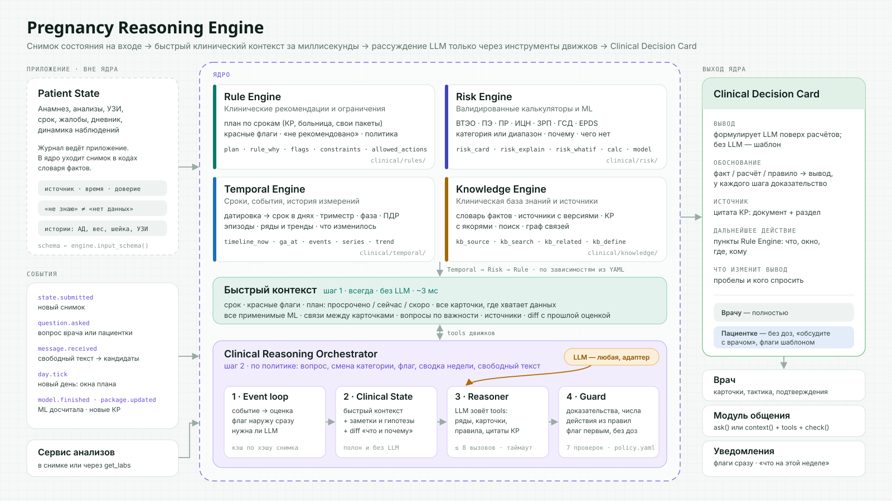

# Pregnancy Reasoning Engine

Ядро femfedora. Приложение присылает снимок состояния пациентки. Ядро за несколько миллисекунд оценивает его по всем фронтам:
- срок;
- план по клиническим рекомендациям;
- карточки рисков;
- ML-модели;
- красные флаги;
- вопросы.

Поверх этой картины LLM рассуждает только через инструменты движков, а каждый её вывод проверяет Guard. На выходе — Clinical Decision Card.



| | |
|---|---|
| Оценка снимка без LLM | **2,6 мс** (прототип на реальных YAML) |
| Пунктов плана по срокам | **89** (76 из КР «Нормальная беременность» + 13 тактики по рискам) |
| Баллы ВТЭО, сверенные с Fomin | **27 / 27**, две ошибки сайта закрыты |
| Красных флагов · ограничений «не рекомендовано» | **16 · 12** |

Статус: архитектура и клиническое содержание (`clinical/`, draft). Движок не написан, прототип оценки нужен только для проверки дизайна.

---

## 1 Быстрый контекст — главный выход ядра

Быстрый контекст — полная картина на дату. Его видит врач в карточке и его же получает LLM в промпт. Считается всегда, без LLM:

- **срок:** неделя+день, триместр, фаза, ПДР, датировка, активные эпизоды;
- **красные флаги** — первыми;
- **план:** просрочено / сейчас / скоро / сделано / нужны данные / по показаниям / чек-лист визита;
- **карточки рисков:** категория (или диапазон, если данных не хватает), баллы, «почему», чего не хватает и меняет ли это категорию;
- **все применимые ML-модели** с режимом показа;
- **вопросы по важности** и кому их задать;
- **источники и diff** с прошлой оценкой.

### Демо-пациентка

Данные: 36 лет, Rh−, партнёр Rh+, ИМТ 30,9, первая беременность, срок 21+3. Вчера госпитализирована с пиелонефритом. Посчитано прототипом по `clinical/`, вход и выход — в `docs/examples/`.

| Раздел | Результат |
|---|---|
| Срок | 21+3 · II триместр · ПДР 02.03.2027 · датировка по КТР в 12+1 · госпитализация, системная инфекция |
| Флаги | нет (последнее АД 128/82) |
| **Просрочено** | антирезусные антитела (18–20 нед) · **допплерометрия 18–20+6** (положена из-за высокого риска ПЭ) · анамнестическая оценка ПР, ИЦН, ЗРП · медпсихолог |
| **Сейчас** | переоценка ВТЭО (из-за госпитализации) · «рассмотреть тромбопрофилактику в стационаре» (только врачу) · ОАК, ОАМ II триместра · прививка от гриппа |
| Скоро | ПГТТ через 17 дней; ещё 18 пунктов дальше, 25 выполнено |
| ВТЭО | баллы 3–10; дородовая профилактика **не позже чем с 28 недель**, возможно с I триместра. Почему: возраст ≥35, ИМТ ≥30, системная инфекция |
| ПЭ (анамнез) | **высокий, определён:** первая беременность, ИМТ ≥30, возраст ≥35 → АСК 12–36 нед (врачу), допплер |
| ML preterm_woman | research; не хватает одного входа — сигарет в день до беременности. Остальное выведено из «первая беременность» |
| Вопросы | 1) варикоз — ответила «не знаю», поэтому врачу на осмотр · 2) ПЭ в текущей беременности — врачу · 3) ВТЭО у родственников — пациентке · 4) тромбофилия — врачу · 5) курение — пациентке |
| Не посчитано | карточки ПР и ИЦН ещё не подключены → серийная цервикометрия в статусе «нужны данные» |

**Проекция для пациентки.**
- Формулировки пунктов плана для неё («Анализ на антирезусные антитела», «Допплер (кровоток)»).
- Пункты только для врача скрыты.
- Риски показываются как «врач обсудит с вами профилактику тромбозов / преэклампсии».
- Вопросы — только к ней.
- Никаких доз.

**Сообщение «сильно болит голова, мушки перед глазами, 150/100, ночью было 96 нижнее».**
1. Извлечение даёт кандидатов фактов.
2. Предварительная оценка поднимает два экстренных флага: `s6.multiorgan` и `s6.dbp_90x2` (КР-288, раздел 6).
3. Утверждённый шаблон «срочно в стационар» уходит пациентке до ответа LLM.
4. Кандидаты возвращаются в приложение на подтверждение.

---

## 2 Устройство

### 2.1 Вход: Patient State из приложения

Журнал фактов ведёт приложение. Ядро состояние не хранит — оно получает снимок в кодах словаря `clinical/knowledge/facts.yaml`:

```json
{
  "schema": "pregnancy-state/0.1", "pregnancy_id": "preg_demo_01", "as_of": "2026-10-23T12:00:00+03:00",
  "fetuses": [{"fetus_id": "f1", "label": "A"}],
  "facts": [
    {"code": "dating.method", "value": "us_crl", "observed_at": "2026-08-19", "level": "document", "source": {"kind": "doc"}},
    {"code": "exam.varicose_veins_gross", "unknown": true, "observed_at": "2026-08-12", "level": "patient_reported", "source": {"kind": "app"}},
    {"code": "episode.hospitalization", "value": {"reason": "пиелонефрит"}, "observed_at": "2026-10-22", "level": "document", "source": {"kind": "doc"}}
  ]
}
```

- **У каждого факта** есть время, источник и уровень доверия: `llm_extracted < patient_reported < document < clinician`. «Спросили — не знает» передаётся как `unknown: true`, «не спрашивали» — отсутствием записи.
- **Схема входа** генерируется из словаря: `engine.input_schema()`.
- **Истории** присылаются для рядов: АД, вес, шейка, биометрия.
- **Анализы** приходят в снимке или ядро берёт их через `get_labs`.
- **Выводимые факты** (`implied`) не спрашиваются. Первая беременность означает: прошлых родов, ПЭ, абортов, кесарева нет.
- **Проверка входа.** Неизвестный код, нет единицы, дата в будущем — всё это попадает в `input_issues`. Целиком снимок не отвергается.

### 2.2 Четыре движка

| Движок | Что считает | Tools для LLM | Данные |
|---|---|---|---|
| **Rule Engine** — клинические рекомендации и ограничения | план по срокам (КР, больница, свои пакеты), красные флаги, ограничения «не рекомендовано», политика ядра, допустимые действия | `plan`, `rule_why`, `flags`, `constraints`, `allowed_actions` | `clinical/rules/` |
| **Risk Engine** — валидированные калькуляторы и ML | ВТЭО, ПЭ, ПР, ИЦН, ЗРП, ГСД, EPDS: категория или диапазон, «почему», чего не хватает; все применимые ML с режимом research / shadow / assist | `risk_card`, `risk_explain`, `risk_whatif`, `calc`, `model_signal` | `clinical/risk/` |
| **Temporal Engine** — сроки, события, история измерений | датировка → срок в днях, триместр, фаза, ПДР; эпизоды; ряды и тренды; что изменилось | `timeline_now`, `ga_at`, `events`, `series`, `trend` | `clinical/temporal/` |
| **Knowledge Engine** — клиническая база знаний и источники | словарь фактов, источники с версиями, тексты КР с якорями, поиск, граф связей | `kb_source`, `kb_search`, `kb_related`, `kb_define` | `clinical/knowledge/` |

Движки идут по зависимостям из YAML: Temporal → Risk → Rule. Knowledge отвечает на запросы и даёт цитаты.

Валидация:
- **Карточка:** `draft → verified` (эталонные кейсы прошли, источник сверен) `→ active` (подпись врача).
- **ML:** `research → shadow → assist`. Правило модель не меняет.

### 2.3 Clinical Reasoning Orchestrator (harness)

| Шаг | Что делает |
|---|---|
| **Event loop** | событие → оценка снимка движками (кэш по хэшу снимка, дате и версии пакета) → красный флаг наружу сразу → решение, нужна ли LLM |
| **Clinical State** | быстрый контекст + заметки LLM + гипотезы связей + diff «что изменилось и почему». Полон и без LLM |
| **Reasoner** | LLM получает событие и контекст и в цикле зовёт tools движков: ряды, карточки, правила, цитаты КР. До 8 вызовов, тайм-аут |
| **Guard** | пропускает только подтверждённое (§3.2) |

LLM подключается через один адаптер: OpenAI-совместимый API подходит для vLLM, Ollama, llama.cpp и шлюзов. Политика данных в конфиге определяет, каким провайдерам можно отправлять реальные данные.

### 2.4 Clinical Decision Card

Состав:
- вывод;
- обоснование (факт / расчёт / правило → вывод, у каждого шага доказательство);
- источник (документ + раздел);
- дальнейшее действие (пункты Rule Engine: что, окно, где, кому);
- что может изменить вывод и кого спросить;
- флаги — первыми.

Проекции:
- **Врачу** — полностью.
- **Пациентке** — без доз, тактика как «обсудите с врачом», флаги утверждённым шаблоном.
- **Без LLM** карточка собирается по шаблону из результатов движков.

---

## 3 Как LLM собирает ответ

### 3.1 Пример: врач спрашивает «Что сейчас важно?»

1. `assess(snapshot)` — быстрый контекст из кэша.
2. `rule_why("kr288.doppler.2")` — допплер положен, потому что `risk.high_obstetric_perinatal` ← ПЭ «высокий»; окно 18+0–20+6 закрыто, исследования нет.
3. `risk_explain("pe_history")` — первая беременность, ИМТ 30,9, возраст 36.
4. `kb_source("kr_288_2023", "2.4")` — «…группы высокого риска акушерских и перинатальных осложнений (ПЭ, ПР, ЗРП) на ультразвуковую допплерографию…».
5. `risk_explain("vte")` — 3 балла известно, до 10 при неизвестных.
6. `finish(result)` → Guard 7/7 → Decision Card.

> **Вывод.** Просрочены допплерометрия (положена при высоком риске ПЭ по анамнезу) и антирезусные антитела 18–20 нед. Госпитализация с системной инфекцией подняла риск ВТЭО: профилактика не позже чем с 28 недель, возможно с I триместра.
> **Дальше:** допплер и антитела сейчас; анти-D в 28–30 нед; переоценка ВТЭО и решение о профилактике в стационаре.
> **Изменит вывод:** курение, ВТЭО у родственников (спросить пациентку); варикоз, тромбофилия (врач).
> **Источники:** КР «Нормальная беременность» 2023, Прил. Б, 2.3–2.4; Fomin: ВТЭО, группа риска ПЭ.

Выход LLM — структура, а не свободный текст:

```json
{"answer": "…",
 "findings": [{"text": "…", "evidence": ["call:3", "fact:…"], "sources": ["kr_288_2023#2.4"]}],
 "links": [{"a": "risk.pe_history", "b": "plan.kr288.doppler.2", "relation": "допплер просрочен при высоком риске ПЭ"}],
 "questions": [{"gap": "lifestyle.smoking", "text": "…"}], "actions": ["kr288.doppler.2"], "uncertain": ["…"]}
```

### 3.2 Guard — 7 проверок (`clinical/rules/policy.yaml`)

1. Каждое утверждение ссылается на вызов tool или факт.
2. Все числа есть в цитируемых результатах.
3. Категории совпадают с Risk Engine.
4. Действия — только из Rule Engine и без нарушения ограничений.
5. Красный флаг стоит первым, утверждённым шаблоном.
6. Пациентке нет доз, схем и гипотез.
7. У клинического утверждения есть источник, и он находится.

Если проверка не прошла, LLM делает одну попытку исправить, потом невалидные части вырезаются.

### 3.3 Когда зовётся LLM

| Ситуация | Режим |
|---|---|
| новый снимок без значимых изменений | без LLM |
| сменилась категория, новый флаг, конфликт, анализ вне нормы | `review` — заметка врачу |
| вопрос или сообщение | `extract` → `answer` |
| новая неделя или открылось окно | `digest` — «что на этой неделе» |
| красный флаг | шаблон уходит сразу; LLM может только добавить объяснение после него |

---

## 4 События

| Событие | Что делает ядро |
|---|---|
| `state.submitted` | приложение прислало снимок: оценка, diff, флаги сразу, при смене категории — заметка врачу |
| `question.asked` | оценка из кэша, рассуждение, Decision Card |
| `message.received` | извлечение кандидатов, предварительная оценка с флагами, ответ; кандидаты уходят в приложение на подтверждение |
| `day.tick` | открылись или закрылись окна плана; раз в неделю сводка |
| `model.finished` | медленная модель досчитала, сигнал ложится рядом с карточкой |
| `package.updated` | новая версия рекомендаций — переоценка всех активных беременностей |

---

## 5 Связи выводятся из данных

| Связь | Откуда |
|---|---|
| Возраст, ИМТ на 1-м визите, многоплодие, ЭКО, АФС → ВТЭО и ПЭ одновременно | общие коды фактов |
| Хроническая АГ, СД → ПЭ и ML-модель ПР | общие коды фактов |
| АД, белок мочи → красные флаги и план визитов | общие коды фактов |
| ВТЭО → тактика: с I триместра / с 28 недель / по анамнезу / после родов | `card: vte` с порядком категорий |
| ПЭ, ПР, ЗРП «высокий» → допплер 18–20+6 и 30–33+6; ПЭ → АСК 12–36 нед | `card: pe_history`, `risk.high_obstetric_perinatal` |
| ПР, ИЦН → серийная цервикометрия 15–24 нед | `card: ptb`, `card: icn` |
| Госпитализация → ВТЭО +1, переоценка, «профилактика в стационаре» | эпизод + `on_event` |
| Роды → послеродовая категория ВТЭО, EPDS, переоценка | `on_event: delivery.date` |
| Первая беременность → прошлых родов, ПЭ, абортов, кесарева нет | `implied` в словаре |

Связи, найденные LLM, хранятся как гипотезы с доказательствами:
- видны только врачу;
- категорий не меняют.

Повторно подтверждённые врач переносит в правила.

---

## 6 Что в репозитории

```text
clinical/
  temporal/  temporal.yaml                         датировка, триместры, фазы, свежесть, ряды, эпизоды
  rules/     kr_normal_pregnancy_2023.yaml         76 пунктов Прил. Б КР-288 + 12 ограничений «не рекомендовано»
             femfedora_risk_assessments.yaml       13 пунктов: оценки на 1-м визите, переоценка ВТЭО, тактика по категориям
             red_flags.yaml                        16 флагов: КР-288 §6, EPDS п.10, подозрение на ВТЭО
             policy.yaml                           правила ядра и Guard
  risk/      vte.yaml  pe_history.yaml  epds.yaml  анкеты с эталонными кейсами
             models/preterm_woman.yaml             адаптер существующей модели: входы из фактов, область, режим
  knowledge/ facts.yaml                            147 кодов, 9 выводятся без вопроса
             sources.yaml                          источники и статусы сверки
docs/
  Pregnancy_Reasoning_Engine_RU.md · .svg · .png   этот документ и схема
  examples/state_snapshot.example.json             вход демо-пациентки
  examples/fast_context.example.json               выход прототипа
```

Сверено:
- баллы ВТЭО совпадают с калькулятором Fomin (RCOG 2015) по всем 27 пунктам;
- у сайта две ошибки, и обе у нас закрыты: ИМТ ≥30 и ≥40 суммируются; факторы родов попадают в дородовую категорию;
- все коды в YAML есть в словаре;
- эталонные кейсы ВТЭО и ПЭ проходят.

---

## 7 Техническое

### 7.1 API

```python
engine = PregnancyReasoningEngine.load("clinical/", llm=OpenAICompat(url, model), labs=MyLabs(), db=dsn)

engine.input_schema()                                   # JSON Schema снимка для приложения
engine.assess(snapshot, as_of=None, audience="clinician")    # → ClinicalContext, синхронно, миллисекунды
engine.ask(snapshot, question, audience)                # → DecisionCard
engine.submit(event)                                    # асинхронно: state.submitted / message / tick …
engine.subscribe(pregnancy_id, kinds=["flag", "review", "digest", "facts_proposed"])
engine.tools(audience)                                  # если модуль общения ведёт свою LLM
engine.check(answer, context)                           # Guard для чужого ответа
```

### 7.2 Движок и оценка

```python
class Engine(Protocol):
    name: str
    def needs(self) -> set[str]: ...                          # коды фактов и ключи других движков — из YAML
    def evaluate(self, view: StateView, upstream: dict) -> Result: ...   # детерминированно
    def tools(self) -> list[Tool]: ...

def assess(snap, as_of) -> ClinicalContext:                    # шаг 1, без LLM
    view = StateView(snap, dictionary, temporal_cfg, as_of)     # свежесть, эпизоды, implied, уровни доверия
    up = {}
    for engine in ENGINES_IN_DEP_ORDER:                        # temporal → risk (+ML) → rules
        up[engine.name] = engine.evaluate(view, up)
    return ClinicalContext.build(view, up, knowledge)
```

### 7.3 Язык условий

Язык условий один для всех YAML:

- сравнения: `fact` / `latest` + `is` / `in` / `gte` / `gt` / `lt` / `nonempty`;
- `series` — например, ДАД ≥90 дважды через ≥4 ч за 48 ч;
- `active` — эпизод;
- `card` — категория другой карточки, с порядком категорий;
- `timeline` — срок, триместр, фаза;
- `all` / `any` / `not` — трёхзначная логика: неизвестное остаётся неизвестным;
- `if_unknown` — автор правила явно решает, как трактовать «неизвестно»;
- `manual` — решает врач;
- `recent` — свежесть.

Ключи событий называются `on_event`: ключ `on` в YAML читается как `true`.

### 7.4 Хранение (только своё)

```sql
assessment     (pregnancy_id, state_hash, as_of, package_version, context jsonb, diff jsonb, created_at)
reasoning_run  (id, pregnancy_id, state_hash, mode, llm, prompt_hash, tool_calls jsonb, result jsonb, guard jsonb, ms)
outbox         (id, pregnancy_id, kind, payload jsonb, created_at, delivered_at)
cache          (key, tool, version, inputs_hash, output jsonb, created_at)
```

### 7.5 Раскладка кода

```text
src/pregnancy_engine/
  api.py  view.py  conditions.py  assess.py
  engines/temporal/  engines/risk/  engines/rules/  engines/knowledge/
  harness/  events.py  loop.py  policy.py  reasoner.py  guard.py  render.py  cards.py
  llm/      port.py  openai_compat.py  safety_lexicon.py
```

---

## 8 Пять правил

1. **Код считает.** Баллы, категории, сроки и флаги не зависят от того, какая LLM подключена.
2. **«Не знаю» ≠ «нет».** Неизвестное остаётся неизвестным и превращается в вопрос нужному человеку.
3. **Медицина в YAML.** Окна, условия, баллы и пороги ревьюит врач, а не программист.
4. **У всего источник.** Каждый пункт, балл и флаг ссылается на место в документе.
5. **Модель не меняет правило.** ML — отдельный сигнал с режимом показа.

## 9 Дорога к MVP

1. **Контракт входа** — схема снимка из словаря, проверка, выводимые факты.
2. **Temporal + Rules** — план КР-288, флаги, ограничения.
3. **Risk** — анкеты ВТЭО, ПЭ, EPDS, калькуляторы, адаптер preterm_woman.
4. **`assess()` + Decision Card по шаблону.** На этом шаге приложение уже получает полный быстрый контекст.
5. **Harness** — события, outbox, новый день, политика вызова LLM.
6. **Knowledge** — тексты КР с якорями, поиск, граф связей.
7. **Reasoner + Guard** — режимы `extract`, `answer`, `review`, `digest`.
8. **ПР, ИЦН, ЗРП, ГСД** — пороги из профильных КР и пакет Наро-Фоминской больницы.

**Готово, когда:**

- 30+ синтетических беременностей, размеченных акушером, проходят как серии снимков;
- оценка снимка укладывается в p95 < 50 мс без медленных ML;
- ~100 вопросов проходят Guard, все красные флаги из тестовых текстов пойманы;
- две разные LLM дают одинаковый быстрый контекст;
- Decision Card строится и без LLM.

**Не делаем, пока не понадобится:** Kafka, векторную БД, отдельные сервисы на движки, workflow-DSL, хранение состояния в ядре.

## 10 Открытые решения

1. **Видит ли пациентка категорию риска** или только «обсудите с врачом» (`policy.yaml → patient_view`)?
2. **Где рассуждает чат:** внутри ядра (`ask`) или в модуле общения (`context` + `tools` + `check`)?
3. **Какая LLM разбирает текст пациентки:** локальная или на российском хостинге?
4. **Анализы в снимке или через `get_labs`?** Нужны коды сервиса анализов.
5. **Кто подписывает пакеты** (`draft → active`). Возраст в ВТЭО: «≥35» (Fomin) или «>35» (RCOG)? Нужен файл страницы Наро-Фоминской больницы.

---

Источники: [КР «Нормальная беременность» 2023](https://legalacts.ru/doc/klinicheskie-rekomendatsii-normalnaja-beremennost-odobreny-minzdravom-rossii/) · [Fomin: ВТЭО](https://calculator.fomin-clinic.ru/tools/risk-vteo) · [Fomin: ПЭ](https://calculator.fomin-clinic.ru/tools/test-preeclampsia) · [Fomin: ВТЭО в анамнезе](https://calculator.fomin-clinic.ru/tools/profilactic-vteo) · [Fomin: EPDS](https://calculator.fomin-clinic.ru/tools/postnatal-depression-scale) · [RCOG GTG 37a](https://www.rcog.org.uk/guidance/browse-all-guidance/green-top-guidelines/reducing-the-risk-of-thrombosis-and-embolism-during-pregnancy-and-the-puerperium-green-top-guideline-no-37a/)

Демо-пациентка вымышленная. Клинические пакеты в статусе draft и не предназначены для решений о лечении до подписи врача.
