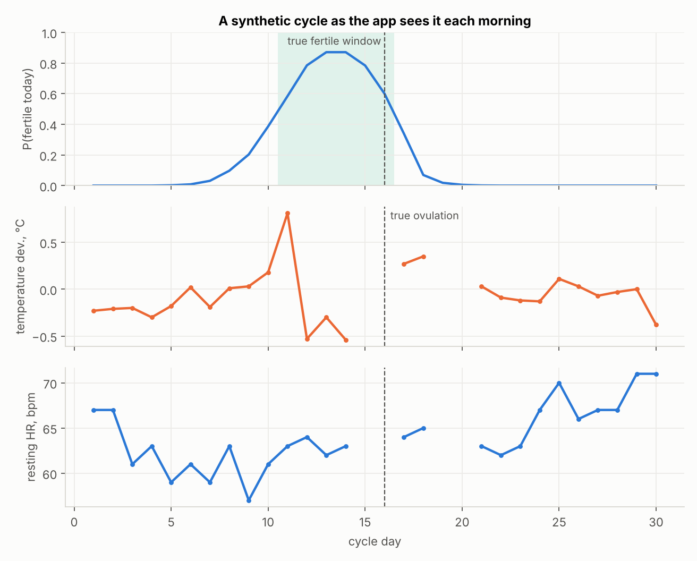
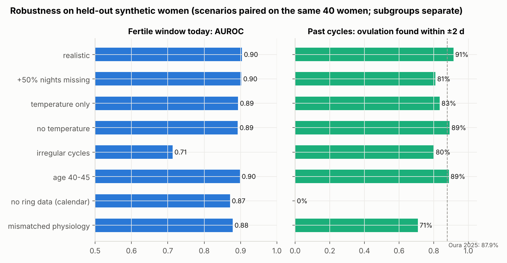
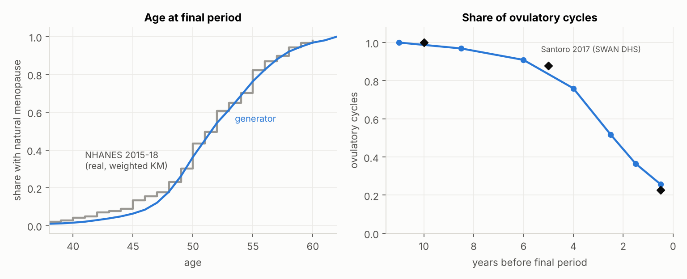
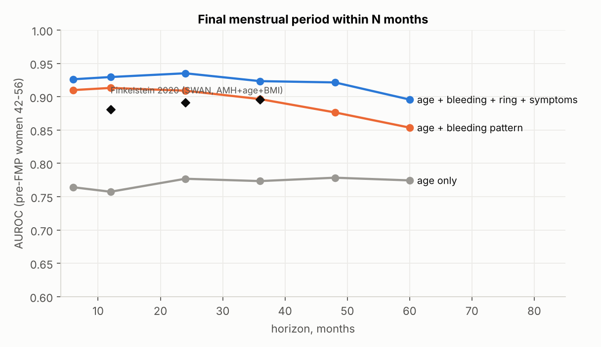

# Ring Health v3: модели цикла и менопаузального перехода по данным умного кольца

Дата: 9 ноября 2026. Версия: ring-health-v3.0.0. Заменяет v1/v2 (они сохранены как история).

## Коротко

Сделаны два модуля анализа. Оба подключаются к приложению одним вызовом (Python, HTTP или карточка ядра femfedora) и получают данные в формате Oura API.

1. **Цикл и фертильность**, по образцу Oura Cycle Insights / Fertile Window:
   - день и фаза цикла;
   - вероятность фертильного дня сегодня и на 7 дней вперёд, даты окна;
   - статус овуляции: прогноз или подтверждение с датой;
   - прогноз следующих месячных;
   - история циклов: овуляции, лютеиновая фаза, возможные ановуляторные циклы;
   - качество данных и подсказка о незалогированных месячных.
2. **Менопаузальный переход**:
   - стадия STRAW+10 с вероятностями;
   - вероятность, что последняя менструация (FMP) уже была или будет в течение 6/12/24/36/48/60 месяцев, и медианное время до неё;
   - индекс ночных приливов.

Модели обучены на синтетике. Генератор построен на физиологии и откалиброван по:
- опубликованным данным Oura, SWAN, InterLACE, Ava, WHOOP;
- реальным открытым данным: FedCycleData — 1 665 циклов, 159 женщин; NHANES 2015–2018 — 2 554 женщины.

Отдельно модели проверены на реальных данных там, где это возможно. Цифры ниже — точность на отложенных синтетических людях. Это не клиническая точность на пользовательницах кольца.

| Задача | v3 (отложенный синтетический тест) | Ориентир из литературы |
|---|---|---|
| Овуляция в прошлых циклах: найдена / MAE / в пределах ±2 дней | 94,8% / 0,85 дня / 94,6% найденных (89,7% всех овуляторных) | Oura JMIR 2025: 96,4% / 1,26 дня / 87,9% |
| Ложное «овуляция найдена» в ановуляторных циклах | 9,9% (404 цикла) | Oura не сообщает |
| Фертильный день сегодня, AUROC (каждое утро, только данные до этого утра) | 0,896 | — |
| Фертильное окно: ≥ 3 из 6 дней отмечены / хотя бы 1 день | 89,2% / 94,5% циклов | Ava (Goodale 2019): окно найдено в 90% циклов |
| Чувствительность / специфичность по дням окна | 0,79 / 0,84 | Oura: ≥ 70% фертильных дней для регулярных циклов |
| Следующие месячные, медиана ошибки: день 3 цикла / после овуляции | 2 / 1 дня (MAE 3,7 / 1,9) | — |
| FMP в течение 12 / 24 / 36 мес, AUROC (42–56 лет, до FMP): кольцо + логи + дата + симптомы | 0,94 / 0,94 / 0,93 | АМГ + возраст + ИМТ (SWAN): 0,88 / 0,89 / 0,90 |
| То же + ФСГ/АМГ и ковариаты | 0,96 / 0,97 / 0,96 | — |
| Только кольцо, без логов / только возраст | 0,84 / 0,85 / 0,82 и 0,77 / 0,78 / 0,77 | возраст: C 0,84 в более широком возрастном диапазоне |
| Стадия: 4 класса / 3 группы, macro-F1 | 0,75 / 0,86 | — |

Синтетические метрики — **верхняя граница**: модель восстанавливает физиологию, заложенную в генератор. Проверка на «несовпадающей» физиологии — в разделе о пропусках.

**Реальные данные:**
- FedCycleData: календарный прогноз овуляции следующего цикла с MAE 1,79 дня (76% в пределах ±2), длины цикла — 2,07 дня; календарное окно AUROC 0,93.
- NHANES: медиана возраста естественной менопаузы 52,0 года (SWAN — 52,5).

## Что было в v1/v2 и что изменено

| Проблема v2 | Решение в v3 |
|---|---|
| Байесовская модель использовала только температуру; ЧСС, HRV и дыхание шли в отдельный ML-сигнал | Единая модель правдоподобия по четырём сигналам. Шаблоны и шумы обучены на тренировочных людях. Без температуры ЧСС, HRV и дыхание находят 94% овуляций ретроспективно |
| Нет персонализации, широкий популяционный априор → окно F1 0,52–0,57 | Эмпирический Байес по прошлым циклам: своя фолликулярная и лютеиновая фаза, амплитуды, частота ановуляции. Априоры — реальные данные FedCycleData |
| Обнаружение 70% при полных данных; обвал при 30% пропусков (F1 0,09) | Обнаружение 94,8%; устойчиво к пропускам (см. «Пропуски») |
| Незалогированная менструация давала ошибки −20…−55 дней | Сравнение гипотез «новый цикл начался в день N» по маргинальному правдоподобию; выдаётся вопрос пользовательнице |
| Нет прогноза месячных и фазы цикла | Есть, с 80% интервалами |
| Синтетика: шум температуры 0,07–0,12 °C — в 2 раза оптимистичнее реального Oura | Шум откалиброван к Oura (Maijala 2019): ночной SD 0,215 против 0,20 ± 0,07 °C |
| Менопауза: только классификатор стадии на синтетике, нет FMP-прогноза, нет связи с реальными данными | Генератор перехода (NHANES + SWAN + InterLACE), STRAW+10, FMP по горизонтам, приливы; проверка генератора против опубликованных таблиц |
| Индикаторы пропусков как признаки (урок ревью preterm и КТГ) | Не используются. Обучение со случайным, не связанным с исходом скрытием входов |

## Что найдено в литературе и как устроен Oura

- **Алгоритм овуляции Oura (JMIR 2025)** ищет устойчивый подъём ночной температуры пальца на 0,3–0,7 °C: полосовой фильтр, гистерезисные пороги, лютеиновая фаза 7–17 дней. Эталон — день после последнего положительного LH-теста. Циклы с >40% пропусков исключены. Результат: 96,4% обнаружения, MAE 1,26 дня, 87,9% в пределах ±2 на 1 155 циклах. Это ретроспективная оценка, ановуляторные циклы не проверялись.
- **Fertile Window Oura**: ≥70% точности для регулярных циклов, прогноз до 6 дней вперёд.
- **Natural Cycles + Oura**: FDA 510(k) K202897 (2021), 40 женщин, 223 цикла. С кольцом в среднем на 1,6 больше «зелёных» лютеиновых дней, чем с оральным термометром.
- **Перименопауза:** у Oura есть отчёт для 100 000+ пользовательниц (не рецензирован) — HRV на 20–30% ниже, до 2 часов сна в неделю меньше в постменопаузе — и Menopause Insights с симптомами. Опубликованной валидированной модели времени до FMP по кольцу нет. Модели по носимым устройствам для FMP в литературе не найдены.

Подробнее: [доказательная база фертильности](experiments/evidence_fertility.md), [доказательная база менопаузы](experiments/evidence_menopause.md).

## Датасеты (проверено 9 ноября 2026)

| Набор | Статус | Как использован |
|---|---|---|
| **FedCycleData** (Marquette) | Найдено открытое зеркало CSV на GitHub; на официальной странице нет CC-лицензии | Реальные априоры фаз и реальный бенчмарк календарного прогноза |
| **NHANES 2015–2018** RHQ/DEMO/BMX | Открыт, уже был скачан в v1 | Реальная модель выживаемости возраста менопаузы и ковариаты |
| **TempID** (Zenodo, CC-BY) | Открыт | Реальная проверка температурного пути на другом сенсоре |
| mcPHASES (PhysioNet) | По-прежнему «files no longer available», новой версии нет | Недоступен |
| haammar/fem-state (HF) | Открыт, похоже на производную mcPHASES | Карантин: не подтверждены происхождение и лицензия |
| SWAN (ICPSR 253) | Визит 09 публичный (ICPSR 32721), нужна учётная запись; из этой среды не скачать | Приоритет для реальной проверки FMP-модели |
| Симптомы/циклы WHOOP, Kindara, Natural Cycles, Apple WHS | Только код или агрегаты, данные по запросу | Опубликованные величины — параметры генератора |

Открытого набора «ночи кольца + гормоны/LH + исходы менопаузы» нет. Поэтому синтетика нужна, а реальные данные используются для параметров и проверок, но не подменяют обучение.

## Что измеряет кольцо и как это использовано

Кольцо Oura не отдаёт гормоны и сырой PPG через API. За ночь доступны:
- отклонение температуры кожи пальца от личной базы (`daily_readiness.temperature_deviation`);
- минимальная ЧСС, средняя HRV (RMSSD), частота дыхания;
- длительность сна, эффективность, время бодрствования.

Все модули v3 работают только на этих полях плюс то, что вводит пользовательница: даты месячных, LH-тесты, симптомы, при наличии ФСГ/АМГ.

| Сигнал | Что известно | Как заложено в генератор и модель |
|---|---|---|
| Температура | Oura: разница лютеиновой и фолликулярной фаз 0,30 ± 0,12 °C, ночной разброс 0,20 ± 0,07 °C (Maijala 2019). Алгоритм Oura ищет подъём 0,3–0,7 °C (JMIR 2025). Чёткий двухфазный профиль у 72–83% (Alzueta 2024) | Амплитуда плато N(0,30; 0,12), шум AR(1) с медианой SD 0,16, медленный дрейф, лихорадка, алкоголь, перелёты, выбросы. Проверка генератора: 0,31 ± 0,13 и 0,215 ± 0,063 °C против опубликованных 0,30 ± 0,12 и 0,20 ± 0,07 |
| ЧСС покоя | +2,1 уд/мин в фертильном окне и +3,8 в середине лютеиновой фазы (Shilaih 2017); около +3,9 от фолликулярного минимума до поздней лютеиновой (Goodale 2019); обзор: 2,7–3,9 | Лютеиновое плато ~3,4 уд/мин и доовуляторный подъём 0,35 от плато: ЧСС начинает расти внутри фертильного окна, поэтому несёт проспективную информацию |
| HRV (ln RMSSD) | Колебание 9–14% за цикл (WHOOP 2026) | Лютеиновое снижение ≈ 10% |
| Дыхание | Колебание 2,7–3,3% (WHOOP 2026); фертильное окно −0,48, поздняя лютеиновая +0,22 (Goodale 2019) | Лютеиновый подъём ≈ 0,45 вдоха/мин |
| Фазы цикла | Реальные данные FedCycleData, 1 499 циклов, 157 женщин: фолликулярная фаза 16,0 дня, межличностное SD 2,8, внутриличностное медиана 1,9 (RMS 2,3); лютеиновая: межличностное SD 1,5, внутриличностное 1,1; корреляции −0,42 и −0,20; возраст −0,14 дня/год | Иерархическая модель фаз — эти оценки по реальным данным; лютеиновая 12,8 (FedCycle 13,2 / Bull 12,4) |
| Ановуляция | 5,5–12,8% циклов (BioCycle), 8,8% циклов без пика (FedCycle) | Персональная частота: 7% до 35 лет, 10% в 35–40, 15% в 40–45 |
| LH | Овуляция в среднем через 32 ч после начала пика; 76% — на следующий день после пика в моче | P(+ | смещение от овуляции): −2: 0,40; −1: 0,90; 0: 0,50 |
| Пропуски | Данные в 97% дней в исследовании Oura, но у 4 из 22 бывали циклы с >50% пропусков; Oura исключает циклы с >40% пропусков | Смесь «хорошая / средняя / плохая» носка (93–99 / 80–93 / 55–80%), эпизоды разной длины, у 15% длинный перерыв 1–3 недели, выпадение отдельных каналов. Логирование месячных: 70% записывают всё, 20% пропускают 10%, 10% пропускают 25%; сдвиг даты ±1–2 дня у 15% |

Все 74 параметра с источниками и типом — литература, подгонка по реальным данным, производная величина или допущение — лежат в `research/experiments/ring_health/v3/parameter_registry.json` (код: `src/ring_health_v3/params.py`). Допущения отмечены явно и меняются в стресс-сценариях.

## Генератор синтетики: математика

### Цикл

Для каждой женщины i генерируются:
- (μF,i, μL,i) — двумерное нормальное распределение с параметрами FedCycleData;
- σF,i, σL,i — лог-нормальные;
- 12% женщин — нерегулярный подтип с σF 4–9 дней;
- персональные амплитуды и шумы каждого сигнала.

В цикле c: F = round(μF + σF·z₁), L = round(μL + σL·z₂), corr(z₁, z₂) = −0,2. С вероятностью pан,i цикл ановуляторный, а его длина ~ N(μF + μL + 4; 7).

Скрытые физиологические кривые:
- прогестероновый эффект P(t): логистический подъём после овуляции (середина через 0,8–2 дня, ширина 0,35–0,9) с падением за 1–2 дня до месячных; для ЧСС и HRV — более медленный спад, переходящий в следующий цикл;
- эстрогеновый доовуляторный горб E(t) с центром в O−1.

Наблюдения за ночь t:
- T = Aᵢ·mc·P(t) + AR(1)ᵢ + дрейф + лихорадка + алкоголь + перелёт + выброс
- ЧСС = базаᵢ + Hᵢ·(P_ЧСС + wᵢ·E) + AR(1) + 8·лихорадка + алкоголь
- ln RMSSD = базаᵢ(возраст) − hᵢ·P_ЧСС + AR(1) − эффекты
- ЧД = базаᵢ + rᵢ·P + AR(1)

Затем накладываются пропуски ночей, каналов и логов.

### Менопаузальный переход

1. **Возраст последней менструации (FMP).** Обратная функция взвешенной кривой Каплана–Мейера по реальным NHANES 2015–2018 (2 554 женщины, 898 естественных менопауз; операции — цензурирование). Ранний хвост пересчитан на InterLACE: до 40 лет — 1,2%, 40–44 — 4,7%. Причина: самоотчёт NHANES даёт 13% до 45 лет. Сдвиги по реальной модели NHANES: высшее образование +1,8 года, роды +0,9; курение −1,2 (SWAN). Результат генератора: медиана 51,5, SD 4,5, 6,4% до 45 лет. Опубликованные медианы: NHANES 52,0, SWAN 52,5, InterLACE 50,0, SD 4,4.
2. **Стадии STRAW+10.** Длительность всего перехода — медиана 5,0 года, позднего перехода — 2,5 года (Paramsothy 2017: 4,4–8,6 и 2,2–3,4 по квартилям); у курящих переход в 1,4 раза короче.
   - Ранний переход генерируется так, чтобы определяющий критерий STRAW был наблюдаем: стойкая разница длин циклов ≥ 7 дней в пределах 10 циклов. После калибровки критерий срабатывает в 89% первых 10 циклов раннего перехода. До 40 лет — в 25% окон репродуктивного периода; реальный FedCycleData: 23% в целом, 12–30% по возрастам.
   - Поздний переход начинается с первого интервала ≥ 60 дней.
3. **Доля овуляторных циклов** по годам до FMP — интерполяция SWAN DHS (Santoro 2017): 100% за 10 лет, 87,9% за 5 лет, 22,8% в последний год. В генераторе за последний год получается 25%.
4. **Гормоны.**
   - ФСГ: траектория Randolph 2011 — начало роста за 6,1 года, ускорение за 2,05 года, плато через 2 года после FMP.
   - АМГ: log-линейный спад; наклон и разбросы подобраны сеткой под опубликованную таблицу 4 Finkelstein 2020, P(FMP ≤ 12 мес | АМГ, возраст). Ошибка — 0,04–0,05 по вероятностям, r = 0,94.
5. **Приливы.** Четыре траектории SWAN с опубликованными долями: low 27%, early 18,4%, late 29%, high 25,6% (Tepper 2016). Ночное число приливов — Пуассон. Ночной прилив повышает ЧСС на ~4 уд/мин и снижает HF-HRV на ~38% (de Zambotti 2013). Вклад в ночные агрегаты — допущение, проверенных величин нет: +0,05 °C, +3–12 мин бодрствования, −1,6% эффективности.
6. **Возрастные и стадийные эффекты.** HRV −0,025 ln/год. В позднем переходе и постменопаузе −0,12 ln, что соответствует отчёту Oura о HRV на 20–30% ниже в перименопаузе (с учётом возраста). В постменопаузе сна на 17 мин/ночь меньше (около 2 ч в неделю, отчёт Oura).
7. **Точки наблюдения.** Возраст каждой точки берётся из единого распределения 38–62 лет для всех женщин. Это популяционный срез: если привязывать точки к FMP самой женщины, P(стадия | возраст) смещается.

Синтетика никогда не приписывается реальным людям. Реальные данные использованы только для параметров, калибровки и бенчмарков.

## Модели

### Цикл: байесовская модель скрытого дня овуляции

Для каждого цикла считается апостериорное распределение дня овуляции O ∈ {6…} и отдельной гипотезы «ановуляторный цикл». Сигнал s в ночь t:

y_s(t) = μ_c + a_s · g_s(t − O) · e_s(дней до месячных) + ε, где ε — AR(1).

- Смещение цикла μ_c ~ N(база, τ²) и амплитуда a_s ~ N(m_s,i, v_s,i) интегрируются аналитически: лемма об определителе матрицы и формула Шермана–Моррисона. Одна факторизация Холецкого на цикл, все кандидаты O за O(n·|O|).
- Ковариация AR(1) считается по фактическим датам наблюдённых ночей. **Пропущенная ночь просто отсутствует**: ничего не заполняется, корреляция через разрыв ослабевает как ρ^Δt.
- Шаблоны g_s, хвосты e_s, амплитуды и шумы обучены на 300 синтетических женщинах (3 900 циклов) регрессией с фиксированными эффектами цикла. Мягкий коэффициент λ = 0,7 выбран на валидации (сравнивались 0,7 и 1,0).

Априор O — личный: среднее и SD фолликулярной фазы оцениваются по прошлым циклам эмпирическим Байесом со сжатием к реальным априорам FedCycleData. Так же — лютеиновая фаза, амплитуды сигналов и частота ановуляции.

Дополнительные свидетельства:
- **Завершённый цикл:** правдоподобие лютеиновой фазы (длина − O).
- **Текущий цикл:** «месячных ещё нет», с учётом неполного логирования: P = S_L(t − O) + (1 − S_L)·q.
- **LH-тесты:** P(+ | смещение).
- **Ночи с вероятной лихорадкой** (скачок температуры с ЧСС) исключаются.

Незалогированные месячные: если цикл неправдоподобно длинный, сравниваются маргинальные правдоподобия «один цикл» и «цикл до N + новый цикл с N» для всех N. Если вероятность разбиения ≥ 0,8, приложение получает предложение подтвердить дату.

Решения и выходы:
- **Фертильный день:** P(O ∈ [t, t+5]).
- **Подтверждение овуляции в реальном времени:** P(O ≤ t−2) ≥ 0,99, ≥ 50% массы в лучших 3 днях, ≥ 3 ночей температуры после O.
- **История циклов:** P(овуляторный) ≥ 0,9 при концентрации ≥ 0,4.

Пороги подобраны на валидации заранее заданным правилом: максимум попаданий ±2 дня при ≤ 10% ложных срабатываний на ановуляторных циклах. Тест в выборе не участвовал.

**Отрицательный результат:** градиентный бустинг поверх апостериорных признаков ухудшил качество (AUROC 0,901 против 0,913, Brier 0,099 против 0,090 в групповой CV). Он не используется.

### Менопауза: признаки и модели

Признаки (одинаковые в обучении и в приложении):
- возраст;
- кровотечения — дни с последних месячных, число месячных за 6 и 12 мес, медиана, SD и максимум интервалов, интервалы ≥ 60 дней, стойкие разницы ≥ 7 дней;
- кольцо — доля овуляторных циклов по модели цикла, сила периодичности температуры 21–40 дней, вариабельность температуры, индекс приливов за 30 ночей, HRV относительно возрастной нормы, ЧСС, сон;
- самоотчёт о приливах;
- при наличии — ln ФСГ, ln АМГ, курение, ИМТ, роды, образование.

Модели:
- HistGradientBoosting: стадия (4 класса) и FMP ≤ N мес для N = 6…60, с монотонизацией по горизонтам.
- Отдельная модель ночи с приливом на признаках ночи относительно личной 30-дневной базы.

Обучение: 3 000 синтетических женщин × 4 точки наблюдения, валидация 700, тест 1 000 × 3. Модели выбираются по доступным входам: без ночей кольца — модель «возраст + кровотечения». Детерминированное правило STRAW+10: ≥ 12 мес без месячных → постменопауза, FMP подтверждена.

## Пропуски: что происходит и как это проверено

Каждое утро модель видит только ночи, логи и LH-тесты до этой даты. Все сценарии прогнаны после исправлений на **одних и тех же 40 отложенных женщинах** (по 2 цикла, все дни). Разница с базой посчитана парным бутстрепом по женщинам (95% ДИ). Подгруппы — нерегулярные циклы и возраст 40–45 — набраны отдельно.

| Сценарий (одни и те же 40 женщин) | AUROC окна (Δ к базе, 95% ДИ) | Чувств. / специф. | Подтверждение в реальном времени | История: найдено / MAE / ±2 всех (Δ ±2) |
|---|---|---|---|---|
| реалистичные пропуски (база) | 0,904 | 0,82 / 0,86 | 90,5% | 97,0% / 0,85 / 91,4% |
| +50% ночей пропущено | 0,902 (−0,002, -0,016…0,018) | 0,82 / 0,85 | 77,0% | 88,7% / 1,02 / 81,0% (−10,4 п.п.) |
| только температура | 0,893 (−0,011, -0,018…-0,003) | 0,81 / 0,86 | 64,9% | 90,5% / 1,11 / 83,5% (−7,9 п.п.) |
| без температуры (ЧСС, HRV, дыхание) | 0,892 (−0,012, -0,021…-0,004) | 0,80 / 0,85 | 0,0% | 97,0% / 1,01 / 89,3% (−2,2 п.п.) |
| нет данных кольца (календарь) | 0,871 (−0,033, -0,052…-0,015) | 0,76 / 0,84 | 0,0% | — (нет физиологии: только календарная оценка) |
| **физиология не совпадает с обучением** (температура ×0,7, шум ×1,3, ЧСС ×0,6, HRV/дыхание ×0,5, лютеиновая −1 день, ановуляция ×2) | 0,878 (−0,026, -0,069…0,017) | 0,77 / 0,81 | 70,5% | 78,9% / 1,06 / 70,9% (−20,6 п.п.) |

Выводы:
- **Пропуски ночей** почти не влияют на окно: при +50% пропусков AUROC −0,002, ДИ включает 0. Подтверждение овуляции в реальном времени снижается с 91% до 77%, оно требует ≥ 3 ночей температуры после овуляции. История находит 89% овуляций.
- **Одна температура** и **без температуры** (ЧСС, HRV, дыхание) дают окно 0,89. Без температуры история находит 97% овуляций. Подтверждение в реальном времени без температуры сознательно не выдаётся.
- **Без данных кольца** календарь по личной истории даёт окно 0,871. Обнаружения овуляции нет, только календарная оценка.
- **Несовпадающая физиология** — проверка «верхней границы». Окно устойчиво (0,878, ДИ разницы включает 0), а точная история овуляций падает на 21 п.п. (до 71% в пределах ±2). Это ожидаемое поведение на реальном кольце, пока профиль устройства не откалиброван. Поэтому первый шаг пилота с Sber — калибровка амплитуд и шумов.
- Полный прогон 10 сценариев на 100 женщинах до исправлений ревью лежит в `test_cycle_metrics_paired_prefix_n100.json`. Там же видны 7 ночей подряд вокруг овуляции (AUROC 0,904), новая пользовательница (0,864), незалогированные месячные (0,862) и LH-тесты (0,937).

## Результаты: цикл

### Основной тест: 250 новых женщин, по 2 цикла, каждое утро

| Метрика | Значение |
|---|---|
| Фертильный день сегодня: AUROC / AP / Brier | 0,896 / 0,667 / 0,096 |
| Чувствительность / специфичность / точность | 0,79 / 0,84 / 0,54 |
| Окно: ≥3 из 6 дней отмечены / хотя бы 1 | 89,2% / 94,5% циклов |
| Подтверждение овуляции в реальном времени: доля циклов / MAE итоговой даты / медианная задержка | 86,1% / 1,25 дня / 5 дн. |
| Ложное подтверждение в ановуляторных циклах: реальное время / история | 13,0% (46 циклов) / 12,6% (310 циклов) |
| История (2646 овуляторных циклов): найдено / MAE / ±1 / ±2 | 94,8% / 0,85 / 82,5% / 94,6% (всех: 89,7%) |
| Прогноз даты овуляции на 5-й день / за 3 дня до неё, MAE | 3,6 / 2,9 дня |
| Следующие месячные, MAE: день 3 / через 3 дня после овуляции; в пределах ±2 | 3,66 / 1,89 дня; 54,8% / 76,2% |
| Тест с обогащением ановуляцией (404 ановуляторных циклов в истории): ложное подтверждение история / реальное время; обнаружение овуляторных | 9,9% / 11,8%; 95,0% |

| Подгруппа | AUROC окна | Чувств. / специф. | Окно ≥3 дн. | История: найдено / MAE / ±2 всех | Месячные после овуляции, MAE |
|---|---|---|---|---|---|
| Возраст 40–45 | 0,898 | 0,79 / 0,85 | 88,1% | 93,9% / 0,84 / 88,7% | 1,73 |
| Нерегулярные циклы | 0,713 | 0,55 / 0,74 | 59,6% | 90,5% / 1,23 / 80,2% | 3,26 |

Нерегулярные циклы — главная слабость, как и у Oura, где точность заявлена только для регулярных циклов. В нерегулярных циклах прошлые циклы почти не предсказывают будущее. Окно там нужно показывать с низкой уверенностью: поле `data_quality.confidence` и широкий `interval_80`.

### Реальные данные

| Проверка | Результат |
|---|---|
| FedCycleData: календарный прогноз следующего цикла (априоры leave-one-woman-out), 1369 циклов, 144 женщин | Овуляция MAE 1,79 дня (±2: 75,7%); длина цикла MAE 2,07 (±2: 62,5%); календарное окно AUROC 0,934, чувств./специф. 0,85/0,86 |
| TempID (59 циклов, 39 человек): профиль Oura / профиль устройства из CV по людям | MAE 5,7 / 4,8 дня; ±2: 25,4% / 35,6%; подогнанная амплитуда 0,07 °C при шуме 0,09 °C; лаг {'1': 59} |

FedCycleData показывает, что персонализация работает на реальных циклах. Прошлые овуляции здесь известны по наблюдениям слизи, а в приложении их даёт кольцо. TempID — другой датчик со слабым лютеиновым подъёмом (~0,07 °C при шуме ~0,10 °C), это физический предел, а не проверка кольца. Для нового кольца (Sber) нужна такая же калибровка профиля устройства на 20–30 размеченных циклах.

## Результаты: менопауза

Генератор проверен против опубликованных данных:

| Проверка | Генератор | Опубликовано |
|---|---|---|
| Возраст FMP: медиана / SD / до 45 лет | 51,5 / 4,5 / 6,4% | NHANES 52,0; SWAN 52,5; InterLACE 50,0 / 4,4 / 5,9% |
| Доля овуляторных циклов: 10–12 лет / 5–7 лет / 3–5 лет / последний год до FMP | 1,00 / 0,91 / 0,76 / 0,26 | ≈1,00 (10 лет) / 0,879 (5 лет) / — / 0,228 (SWAN DHS) |
| P(FMP ≤ 12 мес \| АМГ, возраст), 21 ячейка таблицы Finkelstein 2020 с ≥20 женщинами | MAE 0,054, r = 0,93 | таблица 4 |
| Критерий раннего перехода (стойкая разница ≥ 7 дней) в репродуктивном возрасте < 40 лет | 25% | FedCycleData (реальные): 23% |

Тест: 1 000 новых женщин × 3 точки в каждом режиме входов. AUROC считается по женщинам 42–56 лет до FMP. Ниже — развёрнутая система целиком: модель выбирается по доступным входам (выбор сделан на валидации), затем применяется правило STRAW.

| Доступные входы (развёрнутая система: маршрутизация + правило STRAW) | FMP 12 / 24 / 36 мес, AUROC | C-индекс | Медиана ошибки, мес | Стадия macro-F1 (4 кл. / 3 группы) | Recall: репр. / ранний / поздний / пост |
|---|---|---|---|---|---|
| Только возраст | 0,77 / 0,78 / 0,77 | 0,63 | 9,3 | 0,42 / 0,57 | 0,93 / 0,07 / 0,00 / 0,84 |
| Только кольцо (без логов и даты) | 0,84 / 0,85 / 0,82 | 0,70 | 11,3 | 0,49 / 0,66 | 0,87 / 0,03 / 0,33 / 0,82 |
| Кольцо + дата последней менструации (без логов) | 0,87 / 0,88 / 0,85 | 0,71 | 8,8 | 0,64 / 0,82 | 0,88 / 0,13 / 0,68 / 0,98 |
| Логи + дата, без кольца | 0,93 / 0,93 / 0,92 | 0,72 | 5,5 | 0,76 / 0,86 | 0,91 / 0,44 / 0,68 / 0,98 |
| Кольцо + логи + дата + симптомы | 0,94 / 0,94 / 0,93 | 0,74 | 5,3 | 0,76 / 0,87 | 0,93 / 0,40 / 0,73 / 0,98 |
| + ФСГ/АМГ и ковариаты | 0,96 / 0,97 / 0,96 | 0,78 | 2,5 | 0,80 / 0,90 | 0,93 / 0,45 / 0,80 / 1,00 |
| Смесь, как в приложении (случайная доступность) | 0,93 / 0,94 / 0,92 | 0,74 | 4,2 | 0,75 / 0,86 | 0,92 / 0,38 / 0,71 / 0,98 |

Маршрутизация, выбранная на валидации: {"labs": "full", "bleeding_ring": "full", "bleeding_only": "age_bleeding", "ring_only": "full", "age_only": "full"}.
Ложное «постменопауза подтверждена» у женщин до FMP (смесь входов): 0,0%.
Модель ночного прилива: AUROC 0,683 на 28140 ночах (доля ночей с приливами 25,6%).
Вклад кольца при наличии логов (режим «всё», без лабораторий): FMP AUROC 12/24/36 полная модель 0,94/0,94/0,93 против «возраст + кровотечения» 0,93/0,93/0,92; стадия F1 0,76 против 0,76.

Что видно:
- Кольцо сильнее всего помогает, когда логов нет. Одно кольцо даёт 0,84 против 0,77 по возрасту; кольцо плюс дата последних месячных — 0,87.
- При полных логах кольцо почти ничего не добавляет к прогнозу FMP (0,94 против 0,93) и не улучшает стадию. Честный вывод для продукта: ценность кольца в менопаузе — пассивный мониторинг без ручного ведения дневника.
- Ложных «постменопауза подтверждена» у женщин до FMP — 0%.

Ранний переход отделяется хуже всего (recall ~0,4). Граница постепенная, и определяющий критерий STRAW+10 (стойкая разница циклов ≥ 7 дней) срабатывает и у 25% женщин до 40 лет; в реальных данных FedCycleData — 23%. Поэтому в приложении стоит показывать группу «переход» и вероятности подстадий: macro-F1 по 3 группам — 0,86.

Модель ночного прилива по ночным агрегатам слабая: AUROC 0,68. Индекс за 30 ночей коррелирует с реальной долей ночей с приливами (r ≈ 0,55). Улучшение — 5-минутный ряд ЧСС из Oura API (`sleep.heart_rate`, всплеск ~4 уд/мин на 1–5 минут при приливе) или кожно-гальваническая реакция, если её даст кольцо Sber.

## Независимая проверка и исправления

Код и метрики проверил отдельный рецензент, не участвовавший в разработке.

**Подтверждено:**
- путей утечки истины (дата овуляции, истинные старты, стадия, время до FMP, приливы, лихорадка) во входы моделей нет;
- seed'ы обучения, валидации и теста не пересекаются;
- правдоподобие совпадает с прямым расчётом многомерного нормального распределения с точностью 1,6·10⁻¹⁴, то есть пропущенная ночь действительно выпадает из модели. Это теперь закреплено тестом.

| Находка | Исправление |
|---|---|
| «Овуляция обнаружена» в прошлых циклах без единой ночи кольца: календарь сам проходил порог | Обнаружение требует ≥ 8 ночей сигналов и ≥ 3 ночей до и после оценки. Иначе это `ovulation_date_estimate` с основанием `calendar_or_sparse_data` |
| Поиск незалогированных месячных сравнивал гипотезы на разных наборах ночей → 43–48% ложных «разбиений» реальных длинных циклов | Единые маски ночей на весь запрос, глобальная маска выбросов, без перенормировки априора на усечённой сетке. Ложные разбиения 50-дневных ановуляторных циклов — 10% |
| Старые логи перекрывали свежую дату из онбординга → ложное «постменопауза подтверждена» | «Дней с последних месячных» берётся по самой поздней из дат. Правило STRAW срабатывает только при надёжном источнике |
| Сценарий «дата последней менструации без логов» не встречался в обучении; пустой лог давал NaN, коррелирующий с исходом | Дата из онбординга при обучении доступна независимо от логов. Пустой лог при ведении логов даёт 0, а не NaN. Доли приливов считаются по наблюдённым ночам |
| Одна дата месячных двухлетней давности: 76 с и «день цикла 717» | Статус `anchor_stale` (> 100 дней) за доли секунды. Сегменты длиннее 100 дней не разбиваются |
| Маршрутизация моделей менопаузы выбрана по тесту | Выбирается на валидации, сохраняется в артефакте. Оценка развёрнутой системы (маршрутизация + правило) воспроизводится кодом |
| Синтетический тест оптимистичен по построению | Добавлен сценарий с несовпадающей физиологией. Синтетические метрики везде названы верхней границей |
| Сценарии на разных женщинах, без ДИ | Парный дизайн и бутстреп разниц |
| Мелочи: сопоставление логов с истинными циклами, видимость лога до начала месячных, двойной учёт выживаемости в прогнозе месячных, знак лага TempID, тавтологический тест, расхождения документации, даты анализов и логирования после `as_of`, старые даты месячных для менопаузы, лишние ключи профиля в адаптере, повторный учёт симптома | Исправлено. Тесты: 24 |

## Как подключить

Контракт и примеры: [docs/ring_health_v3_api_ru.md](../API_REFERENCE.md); пары вход/выход — `data/samples/ring_health/v3/` (16 сценариев).
- Python: `RingHealthV3().analyze(payload)`.
- HTTP: `uvicorn src.ring_health_v3.api:app` или `deployment/ring_health_v3`.
- Ядро: `RingFertilityComponent` и `RingMenopauseComponent` (SHADOW).

Воспроизведение: `python -m tools.train_ring_health_v3 cycle | real | menopause | paired`, затем `tools/build_ring_health_v3_samples.py`, `tools/build_ring_health_v3_figures.py`, `pytest tests/unit/test_ring_health_v3.py` (24 теста). Тесты проходят и в среде проекта (NumPy 2.3.5, pandas 2.2.3, scikit-learn 1.9.1).

## Что можно и нельзя говорить на демо

Можно:
- модели построены по физиологии цикла и перехода, откалиброваны по опубликованным исследованиям и реальным открытым данным;
- на синтетике с реалистичным уровнем шума и пропусков Oura они дают показатели уровня опубликованных результатов Oura/Ava;
- на реальных циклах FedCycleData персональный календарь работает с ошибкой ~1,8 дня.

Нельзя:
- называть это контрацепцией, вероятностью зачатия, диагнозом или клинически валидированной точностью;
- обещать дату менопаузы;
- сравнивать «лучше Oura»: другие данные, эталон и отбор циклов.

Все ответы несут `clinical_validation=not_established`.

## Ограничения

1. **Главное:** нет реальной парной выборки «ночи кольца + LH/УЗИ + исходы». Высокие метрики подтверждают, что модель правильно восстанавливает физиологию, заложенную в генератор, при реалистичном шуме, а не точность на людях. Совместные распределения сигналов, эффекты HRV и дыхания, частоты конфаундеров, модель пропусков и вклад приливов в ночные агрегаты — допущения. Их значения и источники перечислены в реестре параметров.
2. FedCycleData — женщины из программы NFP с регулярными циклами; овуляция определена по слизи.
3. NHANES — самоотчёт о возрасте последней менструации; ранний хвост пересчитан на InterLACE.
4. FMP-модель не проверялась на реальных продольных данных (SWAN нужна учётная запись ICPSR).
5. Генератор менопаузы не моделирует гормональную терапию, хирургическую менопаузу и раннюю недостаточность яичников: в приложении это `out_of_scope`.

## Следующие шаги

1. **Пилот с кольцом Sber:** 100–200 женщин по 3–6 циклов с LH-тестами (и по возможности УЗИ/ПДГ), включая нерегулярные циклы и 40+. Сначала калибровка профиля устройства — амплитуды и шумов, по образцу TempID-CV. Затем замороженный протокол оценки на тех же метриках.
2. **SWAN ICPSR** (визиты 1–10): реальная проверка FMP-модели по кровотечениям, ФСГ и возрасту.
3. **Приливы:** 5-минутная ЧСС из Oura API и метка «прилив» в дневнике.
4. **Если появятся реальные парные данные:** дообучить шаблоны и шумы модели цикла. Код обучения уже принимает реальные циклы с эталонной датой овуляции.

## Источники

- Oura ovulation detection algorithm, JMIR 2025 — https://www.jmir.org/2025/1/e60667
- Oura Fertile Window manual — https://support.ouraring.com/hc/en-us/articles/30561106990227-Fertile-Window-User-Manual
- Maijala et al. 2019, Oura finger temperature and cycle — https://doi.org/10.1186/s12905-019-0844-9
- Alzueta et al. 2024, Oura temperature rhythm, young vs midlife — https://pmc.ncbi.nlm.nih.gov/articles/PMC11416332/
- Goodale et al. 2019, Ava multiparameter fertile window — https://www.jmir.org/2019/4/e13404/
- Shilaih et al. 2017, pulse across the cycle — https://www.nature.com/articles/s41598-017-01433-9
- WHOOP 2026, menstrual cycle physiology (code) — https://github.com/alexgonzl/menstrual_cycle_physiology_sleep_whoop
- Bull et al. 2019, 600k cycles — https://www.nature.com/articles/s41746-019-0152-7
- Wilcox et al. 1995, fertile window — https://www.nejm.org/doi/full/10.1056/NEJM199512073332301
- FedCycleData (Marquette) — https://epublications.marquette.edu/data_nfp/7/ ; mirror https://raw.githubusercontent.com/chiomajaco6/MenstrualCyclePrediction/main/rawFedCycleData.csv
- TempID, Zenodo 20160611 — https://zenodo.org/records/20160611
- mcPHASES, PhysioNet — https://physionet.org/content/mcphases/1.0.0/
- NHANES RHQ codebook — https://wwwn.cdc.gov/Nchs/Data/Nhanes/Public/2017/DataFiles/RHQ_J.htm
- STRAW+10 — https://pmc.ncbi.nlm.nih.gov/articles/PMC3580996/
- Gold et al. 2013, SWAN age at natural menopause — https://academic.oup.com/aje/article/178/1/70/108605
- InterLACE (Zhu et al. 2019) — https://eprints.whiterose.ac.uk/151718/
- Paramsothy et al. 2017, duration of the menopausal transition — https://escholarship.org/content/qt4pv4j4fr/qt4pv4j4fr.pdf
- Santoro et al. 2017, SWAN Daily Hormone Study — https://academic.oup.com/jcem/article/102/7/2218/3063809
- Randolph et al. 2011, FSH/E2 trajectories — https://academic.oup.com/jcem/article/96/3/746/2596797
- Finkelstein et al. 2020, AMH and impending menopause — https://pmc.ncbi.nlm.nih.gov/articles/PMC7067546
- Avis et al. 2015, VMS duration — https://core.ac.uk/download/56530091.pdf
- Tepper et al. 2016, VMS trajectories — https://escholarship.org/content/qt64w2r98p/qt64w2r98p.pdf
- de Zambotti et al. 2013, nocturnal hot flashes HR/HRV — https://pmc.ncbi.nlm.nih.gov/articles/PMC3713094
- Oura Perimenopause Report 2024 (company report) — https://femtechinsider.com/oura-ring-perimenopause-report/
- SWAN data access (ICPSR series 253) — https://www.icpsr.umich.edu/web/ICPSR/series/253
