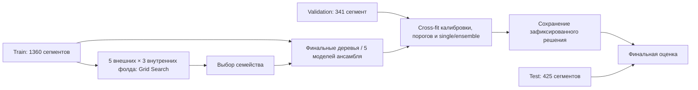

# План обучения и проверки UCI CTG

## Вопрос и ограничения

Сравнить процедуры предсказания экспертного класса `NSP`: normal / suspect / pathologic. Это классификация экспертной разметки КТГ, а не прогноз перинатального исхода. 176 патологических сегментов всего; в исходном train их 112 из 33 исходных файлов, в validation 29 из 7, в test 35 из 10. Пациентки не идентифицированы. Единица разделения и бутстрепа — исходный `source_file`; несколько сегментов одной записи не считаются независимыми пациентками.

Постоянный normal-классификатор нужен как отрицательный контроль: accuracy около 78% не доказывает распознавание патологии. Главная метрика отбора — macro-F1. Также обязательны recall/precision/F1 и Average Precision (AP) патологического класса, balanced accuracy, log loss, multiclass Brier, ROC-AUC, матрица ошибок и интервалы по исходным файлам. AP явно отличаем от трапецеидальной площади под PR-кривой.

## Неподвижные данные

Использовать существующие 1360 / 341 / 425 сегментов train / validation / test. Проверить отсутствие общих `source_file` и одинаковых feature-векторов между частями. Метки `CLASS`, `NSP`, даты, имена файлов и номера строк не являются признаками. `DS` и `Width` исключены по зафиксированному в 01 контракту; все 21 исходное поле остаются в первичной таблице. Решения из предыдущего исследования и просмотренные распределения означают, что test нельзя называть полностью слепым новым набором.

## Сравнение рекомендаций

| Вариант | Реализация и критическая оговорка |
|---|---|
| A | CatBoost MultiClass без весов. Основной контроль. |
| B1/B2 | MultiClass с `SqrtBalanced` и `Balanced`, отдельные одинаковые сетки. Не добавлять одновременно sample weights из 01: это удвоило бы коррекцию. Веса рассчитывает CatBoost заново в каждом fit. |
| C | Три бинарных CatBoost OvR без весов для изоляции архитектуры. Отдельная Platt-калибровка каждого выхода; затем нормировка к сумме 1. После нормировки идеальная калибровка отдельных маргинальных вероятностей не гарантирована — проверяем итоговый Brier/log loss. |
| D | Два CatBoost: normal vs abnormal; затем suspect vs pathologic только среди abnormal. Итог `P(N)=1-a`, `P(S)=a(1-b)`, `P(P)=ab`. У второй стадии меньше данных, а ошибка первой может ограничивать recall. Калибровка стадий раздельная. |
| Простой baseline | Мультиномиальная логистика с регуляризацией и внутренним переобучением преобразователя, плюс константный normal-классификатор. |
| Кластеры | Fuzzy C-Means, KMeans и Gaussian Mixture. Метки не используются ни в fit, ни в выборе числа кластеров. Связь с экспертными классами исследуется только после фиксации конфигурации. Это отдельный анализ, а не заранее обещанное улучшение модели. |

## 02 · Общая вложенная кросс-валидация и Grid Search

1. На исходном train создать общие 5 внешних `StratifiedGroupKFold` по `NSP` и `source_file`, внутри каждого — общие 3 внутренних. Сохранить принадлежность строк фолдам. Validation/test в этом шаге не участвуют.
2. Полная прямоугольная сетка CatBoost через `ParameterGrid`: `depth ∈ {3,5,7}`, `learning_rate ∈ {0.03,0.10}`, `l2_leaf_reg ∈ {3,10}`, `iterations ∈ {300,600}` — 24 комбинации для каждой процедуры. Для C/D общие настройки голов ограничивают число сравниваемых решений. Нельзя заявлять глобальный оптимум за пределами сетки. Early stopping не использует внешние фолды.
3. Для каждой комбинации получить внутренние OOF-вероятности, выбрать по среднему macro-F1, при равенстве — log loss и более простая конфигурация. Сохранить все результаты сетки.
4. Только по внутренним OOF-выходам лучшей комбинации оценить калибровку и порог патологического класса. Внешний holdout не используется для этих оценок. Калибровка и порог используют одни внутренние OOF-данные; возможную переадаптацию этого шага оценивает внешний фолд.
5. Внешне сравнить raw argmax / calibrated argmax / calibrated threshold. Основной threshold выбирается по macro-F1 из сетки 0.10–0.90; argmax тоже кандидат. Получить pooled OOF и разброс по фолдам. Для C calibrated режим обязателен при выборе победителя.
6. Зафиксировать семейство по pooled внешнему macro-F1, при равенстве — log loss. Выбор среди семейств сам создаёт некоторый оптимизм; независимый test остаётся проверкой выбранной процедуры.

## 03 · Калибровка, усреднение и финальный test

1. Для каждого семейства повторить ту же внутреннюю сетку на всём исходном train и обучить одну модель. Validation не используется для деревьев или scaler fit.
2. Для выбранного семейства дополнительно обучить 5 моделей на 4/5 исходного train с одной финальной конфигурацией. Усреднять вероятности, не дискретные ответы. Каждый участник видит меньше данных — усреднение не гарантирует улучшения.
3. На validation провести 3-fold cross-fitting калибраторов и порогов с разделением по исходным файлам. Для single и ensemble калибраторы обучать отдельно на выходах именно соответствующего предиктора. Это избегает переноса калибратора одиночной модели на распределение усреднённых ответов. Sigmoid-регрессия использует фиксированную L2-регуляризацию `C=1`; гибкая isotonic не включается из-за малого числа положительных записей.
4. По validation cross-fit сравнить raw, sigmoid-calibrated и threshold режимы. Выбрать ансамбль только при приросте macro-F1 не менее 0.01; при меньшем выигрыше оставить single. Правило фиксируется до test. Политики остальных семейств тоже фиксируются до test.
5. Обучить выбранные калибраторы и пороги на всей validation, не переобучая деревья на ней: иначе калибровка относилась бы к другой модели. Сохранить финальное решение и его хэш до получения test-метрик.
6. Один раз оценить test для всех заранее зафиксированных процедур. Чемпион не меняется по test. Для главного результата — 1000 bootstrap-повторов по исходным файлам, включая все сегменты выбранного файла; не интерпретировать фолды как независимые измерения для обычного t-теста. Интервалы показывают неопределённость фиксированной модели в этом наборе, не весь разброс повторного обучения.
   Дополнительная заранее заданная рабочая точка: на всей validation выбрать порог калиброванной `P(pathologic)` с recall не менее 0.90 и максимальной specificity, затем отдельно показать его test-результат. Это исследовательский компромисс, а не гарантированный клинический уровень чувствительности; он не меняет основной macro-F1-чемпион.
7. Экспортировать модели, калибратор, порог, схему входов, версии, параметры и происхождение. Для линейного baseline сохраняется собственный scaler, оценённый внутри нужного fit. `scalers.joblib` из 01 не применяется к внутренним validation-фолдам.

## 04 · Кластеризация без результата

1. Clone преобразователя из 01 обучить только на train. Для расстояний убрать дублирующие индикаторы присутствия, стандартизовать числовые измерения; one-hot `Tendency` масштабировать так, чтобы смена категории имела единичное расстояние. PCA с 90% объяснённой дисперсии обучить только на train.
2. FCM: `k=2..6`, fuzzifier `m∈{1.5,2,2.5}`, несколько инициализаций; KMeans: `k=2..6`; GMM: `k=2..6`, covariance diag/full. Сохранять критерии, сходимость, размеры кластеров, FPC/энтропию FCM, BIC GMM и устойчивость между инициализациями.
3. Выбирать конфигурацию внутри каждого алгоритма по silhouette на validation без меток, исключая вырожденные решения. `k=3` не навязывается числом классов. При слабой разделимости так и сообщать.
4. После фиксации — ARI/NMI, таблицы состава кластеров по `NSP`, доля pathologic и её обогащение относительно общего уровня на test. Интервалы — bootstrap по файлам; малые кластеры явно помечаются. Это исследовательские связи с экспертной разметкой, не новые клинические группы риска.

## 05 · Разбор результатов

Свести вложенную CV, validation-решения и test; показать матрицы ошибок, PR/ROC, калибровку, выбранные пороги, ошибки по исходным файлам и ограничения. Отдельно ответить, подтвердилось ли улучшение от весов, архитектуры и fold averaging. Сохранить все ноутбуки выполненными, inspectable таблицы и модельные артефакты. Подбор лучшего результата после просмотра test не допускается.

Методические источники: [CatBoost weights](https://catboost.ai/docs/en/references/training-parameters/common), [calibration](https://scikit-learn.org/stable/modules/calibration.html), [StratifiedGroupKFold](https://scikit-learn.org/stable/modules/generated/sklearn.model_selection.StratifiedGroupKFold.html), [Fuzzy C-Means](https://scikit-fuzzy.readthedocs.io/en/latest/api/skfuzzy.cluster.html).

## 06 · Дополнительная сетка сжатия, с сохранением 04

Это отдельный исследовательский протокол. Предыдущие таблицы, модель и выполненный ноутбук 04 фиксируются SHA-256 и не перезаписываются. Классификационные результаты 02–05 не меняются. Повторно используемый test уже известен исследованию и не является новой слепой когортой.

1. Подготовить ту же матрицу расстояний, что в 04 до PCA: 18 числовых столбцов с train-стандартизацией плюс 3 one-hot категории с единичным расстоянием между категориями. Скейлеры и входной контракт сохранять внутри нового bundle. Нули допустимы; новые пропуски отклоняются, как в 01.
2. Полная сетка представлений: без сжатия — 1; PCA, компоненты 2/5/10 — 3; UMAP, компоненты 2/5/10 × соседи 10/30/60 × min_dist 0/.1/.5 — 27; undercomplete denoising AE, bottleneck 2/5/10 × ширина 16/32 × L2 alpha .001/.1 × tanh/relu — 24. Всего 55. UMAP: евклидова метрика, 300 эпох, n_jobs=1, фиксированные random_state/transform_seed.
3. AE реализовать через sklearn MLPRegressor: симметричные скрытые слои, линейный выход, Adam .001, batch 128, шум .05 на входе при чистой цели реконструкции. Для early stopping отделить 20% файлов внутри train через GroupShuffleSplit без NSP/CLASS, seed+800. Внутренний входной преобразователь fit только на fit-файлах. Выбирать эпоху по MSE реконструкции holdout, patience 60, максимум 1200, минимальное улучшение 1e−5. Затем заново fit на всём исходном train ровно выбранное число эпох. Достижение лимита эпох сохранять; оно не доказывает сходимость. Бюджет увеличен с 300 до 1200 по пилотной диагностике реконструкции: ограничение 300 мешало остановке, а дополнительное обучение снижало внутреннюю holdout MSE (пример 0.2256 → 0.1927, лучшая эпоха 750); NSP в этом решении не использовался.
4. В каждом из 55 представлений повторить всю сетку 04: k=2..6; FCM m=1.5/2/2.5, KMeans, GMM diag/full — по 30 вариантов, всего 1650 сочетаний. Это полный перебор заявленной сетки, не глобальная гарантия оптимальности.
5. Отбирать отдельно внутри каждой пары «представление × алгоритм» по silhouette в **общем пространстве до сжатия**, усреднённому сначала по сегментам каждого validation-файла, затем по файлам. Этот критерий оценивает разделимость в исходной геометрии и не универсален для нелинейных форм. Исключить кластеры <3% train/validation, несходимость/совпадение центров FCM, trustworthiness на validation <.80 (10 соседей). При равенстве меньше компонент, затем k, затем фиксированные ID. Latent silhouette, 10-NN overlap, реконструкцию AE/PCA и GMM BIC сохранять как диагностику. BIC не сравнивать между разными представлениями.
6. Сохранить параметры до просмотра test-признаков и любой связи с NSP. Применить к validation/test только transform/predict. Проверить чувствительность зафиксированных решений на двух дополнительных seed и пяти подвыборках 80% train-файлов; в каждой переобучить скейлеры и сжатие. Сравнивать назначения на неизменной validation через ARI. Не переотбирать по устойчивости или экспертным классам после фиксации.
7. Показать все 12 выбранных решений и прежние результаты 04. После фиксации вычислить ARI/NMI с NSP, доли pathologic/suspect/abnormal и обогащение, 1000 bootstrap-повторов по test-файлам. Интервалы точечные, не исправлены за множественные сравнения; выводы о рисках остаются гипотезами для независимой проверки. Сохранить мягкие принадлежности, скейлеры, редукторы, веса AE, модели, кривые обучения, роли ранней остановки, сетки, версии и контрольные суммы.

Источники: [UMAP и возможные ложные разрывы](https://umap-learn.readthedocs.io/en/latest/clustering.html), [UMAP transform новых данных](https://umap-learn.readthedocs.io/en/latest/transform.html), [MLPRegressor](https://scikit-learn.org/stable/modules/generated/sklearn.neural_network.MLPRegressor.html), [trustworthiness](https://scikit-learn.org/stable/modules/generated/sklearn.manifold.trustworthiness.html).
