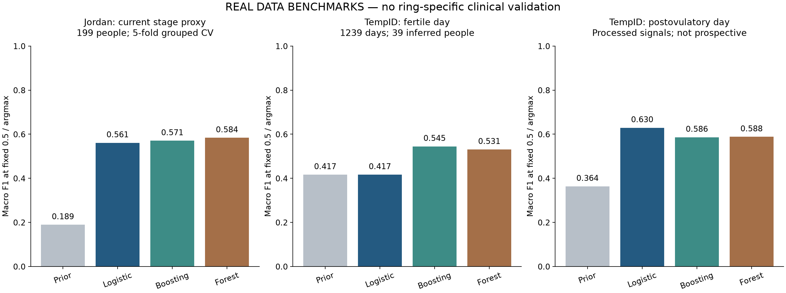
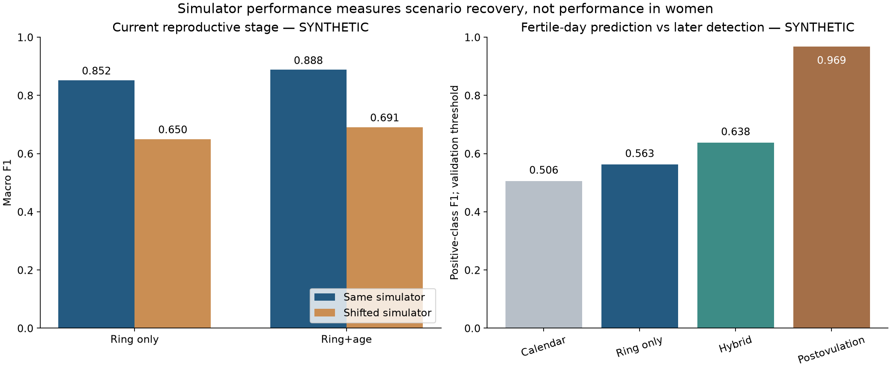
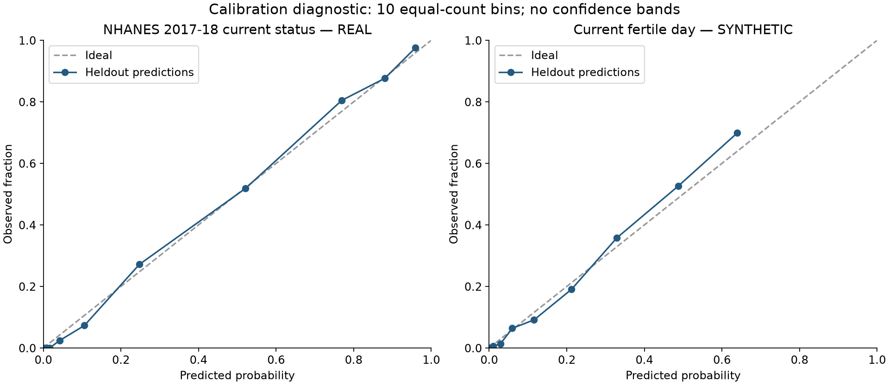
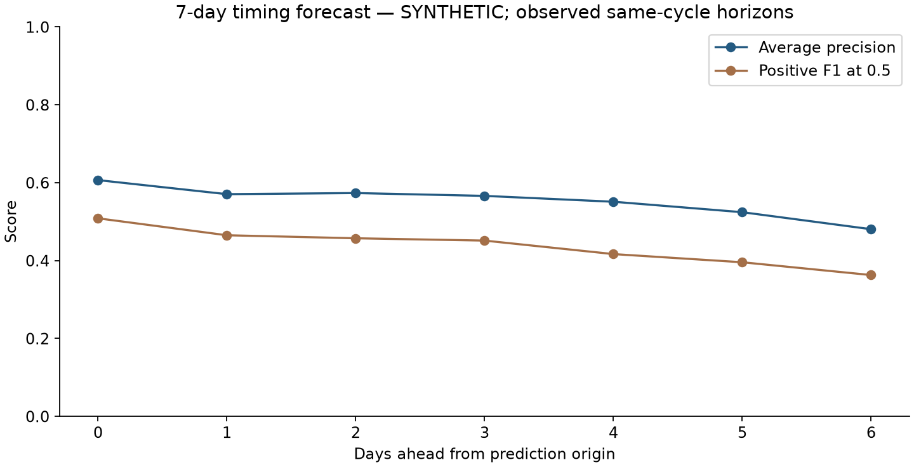

# Модели анализа репродуктивного состояния по данным умного кольца

Историческая версия v1. Актуальная перепроверка и ограничения: [отчёт v2](ring_health_v2_review_ru.md); для интеграции используйте v2.

Дата исследования: 9 ноября 2026. Версия: ring-health-v1.

Подготовлен работающий локальный MVP двух направлений: оценка текущего репродуктивного этапа и анализ фертильного окна. Есть загрузчик данных, воспроизводимое обучение, восемь экспортированных моделей, адаптер JSON Oura v2, CLI и локальный HTTP API. Сравнены логистическая регрессия, градиентный бустинг и случайный лес; сохранены базовые модели, разбиения, прогнозы и контрольные суммы.

На доступных реальных данных удалось проверить отдельные части задачи. Реальные данные, одновременно содержащие репрезентативную историю кольца и надёжную разметку менопаузального перехода, получить в открытом доступе не удалось. Поэтому модели кольца для демонстрации обучены на явно обозначенных физиологически мотивированных сценариях. Их метрики показывают воспроизведение симулятора. Они не устанавливают точность у пользовательниц Oura.

## Что именно предсказывается

| Направление | Реализованный выход | Что ещё не подтверждено |
|---|---|---|
| Репродуктивное старение | Распределение вероятностей reproductive / transition / postmenopause по 90 дням кольца и возрасту; отдельный вариант без возраста | Риск наступления окончательной менструации за 12/24 месяца; время до менопаузы; клиническое определение стадии по одному кольцу |
| Фертильность | Вероятность принадлежности текущего дня шестидневному окну; отдельный сигнал постовуляторного состояния | Вероятность беременности и индивидуальная фертильность |
| Окно на следующие 7 дней | Байесовское распределение даты овуляции по истории циклов и уже наблюдавшейся температуре | Проспективная точность на реальном кольце; интервалы не имеют установленного клинического покрытия |

Менопауза как событие, текущая стадия и выраженность симптомов — разные цели. В STRAW+10 стадирование опирается прежде всего на историю кровотечений; окончательная менструация подтверждается ретроспективно. Ни высокий возрастной ROC-AUC, ни исчезновение температурного ритма сами по себе не доказывают возможность предсказывать дату менопаузы. [STRAW+10](https://pmc.ncbi.nlm.nih.gov/articles/PMC3580996/).

Таргет фертильного дня задан как дни от ovulation−5 до ovulation включительно. Это вероятность принадлежности интервалу, а не вероятность зачатия в конкретный день. Такое определение согласуется с классическим исследованием времени полового акта относительно овуляции. [Wilcox et al](https://www.nejm.org/doi/full/10.1056/NEJM199512073332301).

## Какие сигналы доступны от Oura

Под «auora» в запросе принято кольцо Oura. Использован контракт стандартного API v2, а не предположение о доступе к внутренним сигналам производителя.

| Сигнал | Поле входа MVP | Ожидаемое поле Oura | Единицы и назначение |
|---|---|---|---|
| Ночное отклонение температуры кожи | temperature_deviation | daily_readiness.temperature_deviation | °C относительно внутренней базы Oura; основной температурный сигнал |
| Минимальная ночная ЧСС | resting_hr | sleep.lowest_heart_rate | уд/мин; модель должна обучаться на таком же определении ЧСС |
| Ночная HRV | hrv_ms | sleep.average_hrv | мс; RMSSD; не смешивать с SDNN и единичными дневными значениями |
| Частота дыхания | respiratory_rate | sleep.average_breath | дыханий/мин |
| Продолжительность сна | sleep_minutes | sleep.total_sleep_duration / 60 | исходное значение Oura в секундах |
| Эффективность сна | sleep_efficiency | sleep.efficiency | проценты от 0 до 100 |
| Активность | steps | daily_activity.steps | шаги за день |

Официальный перечень API подтверждает ночные температуру, ЧСС, HRV, дыхание, сон и SpO2. Не следует считать, что открытый API даёт непрерывную сырую температуру, PPG или гормоны. SpO2 в этой версии не используется: для репродуктивных целей его добавочная ценность не установлена в наших данных. [Oura API metrics](https://partnersupport.ouraring.com/hc/en-us/articles/28571089902227-Metrics-Available-via-the-Oura-API), [API v2](https://cloud.ouraring.com/v2/docs).

Адаптер выбирает наиболее длинную сессию long_sleep за день. Сохраняется назначенный Oura day; дата не пересчитывается из UTC начала сна. Отклонение температуры кожи не преобразуется в температуру ядра тела. Oura Readiness, Sleep score и собственные прогнозы цикла не подаются в X: это производные показатели с непрозрачной обработкой и возможной утечкой целевого события.

## Что установлено в исследованиях

В исследовании Oura 2025 года алгоритм ищет устойчивый подъём температуры и оценивался относительно дня после последнего положительного домашнего LH-теста. Разработка использовала отдельные 30 000 циклов. На 1 155 тестовых овуляторных циклах сообщены detection rate 96,4%, MAE 1,26 дня, 87,9% оценок в пределах ±2 дней. Это ретроспективное обнаружение, а не точность заблаговременного окна. Ановуляторные циклы такой дизайн полноценно не проверяет. В тексте есть несогласованность числа участниц: в описании выборки 964, в разделе отбора 1 007; численность циклов согласуется. Авторы — сотрудники Oura, сырые данные не публичны. [Оригинальная статья](https://www.jmir.org/2025/1/e60667).

Руководство Oura Fertile Window отдельно описывает прогноз: для регулярных циклов заявлены ≥70% accuracy фертильных дней и прогноз овуляции до 6 дней вперёд с MAE до 3 дней. Определение accuracy в инструкции нельзя напрямую отождествлять с нашим F1 или переносить на нерегулярные циклы. Natural Cycles и собственная функция Oura — разные продукты; их результаты не взаимозаменяемы. [Руководство производителя](https://support.ouraring.com/hc/en-us/articles/30561106990227-Fertile-Window-User-Manual).

Работы с Oura 2019, 2022 и 2024 годов поддерживают использование температурных и сердечных изменений в ходе цикла. Исследование молодых и женщин среднего возраста отдельно показывает, почему нельзя предполагать одинаковую полезность всех показателей сна. Доказательство различий между фазами не равнозначно оценке индивидуальной ошибки прогноза. Открытые сырые архивы этих работ не были подтверждены. [Maijala 2019](https://doi.org/10.1186/s12905-019-0844-9), [Alzueta 2022](https://doi.org/10.2147/IJWH.S341917), [исследование среднего возраста](https://pmc.ncbi.nlm.nih.gov/articles/PMC11416332/).

Для многомерного подхода релевантна работа Ava: деревья решений использовали несколько физиологических параметров, а не только температурный подъём. Это полезный архитектурный ориентир, но другой прибор и другой протокол. Новая работа 2026 года с 42 759 циклами относится к WHOOP, а не к Oura. [Ava](https://www.jmir.org/2019/4/e13404/), [WHOOP и авторский код](https://github.com/alexgonzl/menstrual_cycle_physiology_sleep_whoop).

Текущая Menopause Insights Hub Oura собирает симптомы через MIS и отображает их влияние и вариабельность циклов. По открытой документации это не валидированная модель времени до окончательной менструации. Women's Health AI в Advisor описывается как интерпретация данных и знаний; опубликованные веса, тренировочный датасет и воспроизводимая оценка FMP-прогноза не найдены. [Menopause Insights](https://support.ouraring.com/hc/en-us/articles/43647048134035-Menopause-Insights-Hub), [описание AI](https://ouraring.com/blog/womens-health-ai-model/).

## Поиск и пригодность данных

Проверялись PhysioNet, Zenodo, Figshare, Mendeley Data, Dryad, CDC/NHANES, SWAN/ICPSR/NIA, NICHD DASH, UK Biobank, исходные публикации и авторские репозитории. Отобраны 27 источников и кандидатов; это широкий документированный поиск, а не гарантия абсолютной полноты. Статусы относятся к проверке 9 ноября 2026. Все записи, лицензии, причины исключения и ссылки сохранены в `data/registry/ring_health_sources.json`.

| Источник | Доступ и полезность | Решение |
|---|---|---|
| Jordan Assaf / предоставленный XLSX | Открытая анкета, 200 строк, текущая стадия-прокси | Подготовлен и оценён отдельно |
| NHANES 2015–2016 | Открытые public-use таблицы; текущий статус и контекст | Скачано 5 таблиц; 853 подходящие строки для development |
| NHANES 2017–2018 | Те же определения в более поздней волне | Скачано 5 таблиц; 815 строк временного теста |
| TempID / Zenodo 20160611 | Температура и аннотированная овуляция; 59 серий | Скачан; только processed-data benchmark |
| mcPHASES | Fitbit + Mira LH/E3G/PdG, 42 человека, 23 таблицы | Очень подходящий кандидат; проверенная страница сообщает, что файлы больше не доступны |
| SWAN ICPSR | Продольные стадии, кровотечения, гормоны, FMP | Приоритет для прогноза будущего события; регистрация и условия конкретной версии |
| SWAN NIA Biobank | Более поздние визиты и подисследования | Требуется одобренный запрос; это та же когорта, не независимая репликация |
| NICHD BioCycle | Повторные гормоны и данные циклов | Запрос через DASH; полезен для таргетов, не содержит эквивалент кольца |
| UK Biobank | Менопаузальная история, здоровье, accelerometry subset | Управляемый доступ; не свободный архив кольца |
| Oura 2019 / 2022 / две работы 2024 / валидация 2025 | Оригинальные исследования | Открытая статья не означает открытые индивидуальные данные |
| Oura–Clue–Berkeley | Исследовательская программа перименопаузы | Публичный датасет и модель FMP не подтверждены |
| Natural Cycles / Dryad COVID study | Статья указывает публичные данные циклов | Кандидат для календарных priors; файлы здесь не получены |
| IFH Affect / Dryad | Реальные Oura + Samsung; архив 8,59 GB | Полезен для preprocessing и конфаундеров; репродуктивный таргет не найден |
| LEMURS DP release | Синтетические опросы исходной Oura-когорты | Не считать сырыми измерениями кольца |
| LifeSnaps | Fitbit Sense, длительное наблюдение | Возможен pretraining; нет подтверждённых гормональных/FMP labels |
| Menopausal MEG / Mendeley | Менопаузальное исследование с MEG | Не соответствует входам кольца |
| Mosconi / NYU / Figshare | Маленькая когорта pre/peri/post, PET и лаборатория | Требуется проверка уровня детализации файлов; не ring-модель |
| Бразильский climacteric survey | Каталог указывает Zenodo | Endpoint/лицензия/строки не подтверждены; карантин |
| Low bone mass / Zenodo 19592608 | Открытые XLSX, но цель — низкая костная масса | Не подменять этим предсказание менопаузы |
| Hugging Face fem-state | Карточка обещает wearable logs и фазы | Карантин: происхождение/права/группы/таргеты и аномальные диапазоны не разрешены |
| UCI Fertility | Мужское качество спермы | Исключён как нерелевантный |

Приоритетные оригинальные страницы: [SWAN](https://www.swanstudy.org/swan-research/data-access/), [mcPHASES](https://physionet.org/content/mcphases/1.0.0/), [BioCycle](https://www.nichd.nih.gov/about/org/diphr/officebranch/eb/biocycle), [TempID](https://zenodo.org/records/20160611), [IFH Affect](https://datadryad.org/dataset/doi:10.7280/D1WH6T). SWAN и BioCycle полезны по разным причинам и не создают автоматически недостающие пары «кольцо—исход».

## Аудит предоставленного датасета

Происхождение установлено: Assaf et al, Quality of life of Jordanian menopausal working and retired women and its associated factors. В статье указан тот же Figshare ID 20822032 и оба предоставленных файла. Статья и анкета использовались как исследовательские материалы, не как инструкции агенту. Лицензия данных в статье — CC-BY 4.0. [Статья](https://doi.org/10.12688/f1000research.125887.2), [версия данных](https://doi.org/10.6084/m9.figshare.20822032.v2).

Исходник содержит 200 строк и 61 столбец, возраст 45–60. Один полный дубликат удалён перед разбиением. Поле `How do you evaluate your health status` по порядку анкеты и совпадению опубликованных частот интерпретировано как прокси стадии: коды 1/2/3 имеют 68/52/80 наблюдений. Код 2 в статье назван menopausal, в анкете — переход с нерегулярными менструациями; исходного codebook нет. Поэтому имя таргета — stage_proxy, а не подтверждённая клиническая стадия. После дедупликации распределение 68/52/79.

Обнаружены существенные ограничения:

- `Loss menstuartion` заполнено у 138 женщин, из них у 58 с кодом стадии не 3. Анкета задаёт вопрос о причине только для третьего этапа. Поле и его маска пропусков исключены: они могут нести разметку и ошибки skip logic.
- 23 пункта QOL в файле имеют значения только 1/2/3; анкета показывает пятибалльную шкалу. Без ключа обратную перекодировку восстановить нельзя.
- `totalqol` во всех 200 строках равен сумме четырёх подшкал. Одновременная подача пунктов и сумм создала бы избыточность; для этой задачи QOL целиком исключён.
- Заголовки болезней сдвинуты/неполны: два столбца Unnamed сопоставлены с типом работы и заболеванием щитовидной железы по порядку и частотам. Коды не выдаются за точные числовые медицинские измерения.
- Children и Pregnancies выглядят категориальными кодами, а не достоверными количествами. Они исключены до получения codebook.
- Симптомы приливов и сна присутствуют в анкете, но соответствующих 17 отдельных симптомных полей в XLSX нет. Времени, длительности аменореи, LH/FSH/AMH, дат циклов и измерений кольца также нет.

Этот файл полезен для аудита и ограниченного сравнения текущей стадии. Даты будущей менопаузы из него научно восстановить невозможно. Итоговый Macro F1 моделей примерно 0,56–0,58 при grouped OOF; это не сильная основа для переносимого продукта.

## Как подготовлены реальные обучающие выборки

NHANES: женщины 35–60 лет; target=1 при RHQ031=2 и RHD043=7, target=0 при RHQ031=1. Остальные причины отсутствия менструаций не обозначаются как менопауза. Исключены известные гистерэктомия/двустороннее удаление яичников. Часть полей и текущая гормональная экспозиция не полностью наблюдаемы, поэтому остаточная неоднородность сохраняется. Отрицательный класс включает часть перименопаузы. [Официальный codebook](https://wwwn.cdc.gov/Nchs/Data/Nhanes/Public/2017/DataFiles/RHQ_J.htm).

Обучение и выбор модели используют только 2015–2016: 639 строк train и 214 validation. Более поздняя волна 2017–2018 — тест, 815 строк. Признаки: возраст; расширенный вариант добавляет BMI, окружность талии, измеренный пульс, сон и возраст менархе. Вопросы, формирующие target, возраст последней менструации, ID и волна не попадают в X. Пульс при осмотре не объявляется ночным пульсом кольца. Дополнительно рассчитаны метрики с весами обследования; обычные bootstrap-интервалы не учитывают полный дизайн NHANES.

TempID: 39 707 почасовых строк, 59 серий, 39 групп людей по префиксу ID. Все серии выровнены на 1 января 2025, каждая имеет среднюю температуру ровно 36,5°C. Авторский код подтверждает центрирование полного цикла и заполнение пропусков с будущим контекстом. Доступного необработанного входа для повторной каузальной подготовки нет. [Данные](https://zenodo.org/records/20160611), [авторская обработка](https://github.com/nach00gar/Monitoring-female-fertile-ground-temperature-measurement-using-a-skin-wearable-and-ML-integration).

Наши признаки TempID инвариантны к постоянному температурному сдвигу: отклонения от медианы строго предыдущих 7 ночей, изменения средних 3 ночей, стандартное отклонение за 7 ночей. Первые 7 дней исключены, чтобы стартовые NaN и растущий размер базы не кодировали позицию относительно события. После этого 1 239 дневных строк. Абсолютное время, relative_event_day, ovulation_timestamp, ID и позиция строки запрещены в X. Четыре кандидата оценены одинаковой 5-fold GroupKFold по людям. Остаточную утечку исходной двусторонней импутации такой код устранить не может.

## Генератор для демонстрации

Созданы 1 500 искусственных людей для стадий и 360 для фертильности. У последних моделируется 5 циклов; первый используется только как история, следующие 4 дают обучающие дни. Во всех разбиениях человек целиком принадлежит train, validation или test. Реальные и искусственные записи не смешиваются.

Физиологические опоры: двухфазный температурный сдвиг; возможные сопутствующие изменения ЧСС, HRV и дыхания; вариабельная фолликулярная и более стабильная лютеиновая фаза; ановуляция; неполная носка; лихорадка, стресс и нарушения сна. Все численные распределения, кроме отдельно указанного литературного диапазона температурного подъёма и определения окна, являются инженерными допущениями. Они не оценены по репрезентативной популяции кольца. Точная таблица допущений находится в `models/configs/training/ring_health_simulator_v1.json`; реализация — `src/ring_health/simulation.py`.

Не применялось клонирование анкет с добавлением выдуманных измерений кольца. Для этого нет наблюдаемых совместных распределений. Не использовались GAN/LLM для выдачи синтетики за реальные пациентские данные. Таргеты хранятся отдельно от признаков. Симулятор генерирует латентное состояние и наблюдения; модель учится восстанавливать заложенные связи, и это ограничивает смысл всех высоких результатов.

Проведён отдельный сценарий с ослабленным температурным сигналом, повышенным шумом и 25–30% неноски; для фертильности повышена частота ановуляции. Это проверка устойчивости к другим предположениям симулятора. Она не заменяет внешний датасет.

## Архитектуры и выбор моделей

Для небольших табличных выборок использованы LogisticRegression, HistGradientBoostingClassifier и RandomForestClassifier. Prior-only DummyClassifier задаёт базу. Гиперпараметры зафиксированы в коде. В демонстрационных и NHANES задачах семейство выбирается по минимальному validation log loss; бинарный порог выбирается по F1 только на validation. Test не используется для выбора семейства или порога. Для Jordan/TempID опубликованы все фиксированные кандидаты; победитель по OOF для развёртывания не выбирается.

Стадия кольца: из последних 90 календарных дней строятся среднее, стандартное отклонение, IQR и доля пропусков каждого сигнала; дополнительно температурная автокорреляция на лагах 20–35 дней и последовательные изменения. Варианты ring_only и hybrid отличаются наличием возраста. Такая периодичность — исследовательский признак, а не самостоятельный диагноз.

Фертильный день: только наблюдения, доступные к утру текущего дня; текущие отклонения от медианы предыдущих 28 ночей, изменения за 3/7 ночей, качество данных. Calendar использует текущий день и длины только прошлых завершённых циклов. Hybrid объединяет обе группы. Confirmation обучается отдельно на постовуляторном состоянии начиная с reference ovulation+2. Все преобразования обучения, включая медианное заполнение, обучаются исключительно на train.

Прогноз окна: отдельный байесовский baseline задаёт распределение возможных дней овуляции и компонент без овуляции. История завершённых циклов задаёт prior; уже наблюдавшаяся температура обновляет его через устойчивое Student-t правдоподобие. Результат — согласованное распределение фертильных дней на 7 дней. Параметры 0,4°C, scale 0,2, likelihood tempering 0,30 и prior ановуляции 0,10 — допущения. До температурного подъёма прогноз в основном календарный. Он не объединяется с вероятностью леса в непрозрачный общий score.

Нейросеть/TCN/Transformer при таком количестве независимых людей не обоснованы как первый выбор. Следующий разумный эксперимент после получения mcPHASES — masked temporal encoder и discrete-time hazard/HSMM с оценкой по людям. Для FMP нужен другой таргет и продольное survival-обучение с цензурированием и конкурирующим риском хирургической менопаузы; текущие stage labels его не заменяют.

## Результаты и их смысл

Точная машинно сформированная таблица всех экспортированных вариантов находится в `research/reports/ring_health_metrics_ru.md`; все кандидаты и исходные прогнозы — в `research/experiments/ring_health/v1`.

| Оценка | Основной результат | Граница вывода |
|---|---|---|
| NHANES, только возраст | ROC-AUC 0,956; positive F1 0,850; Brier 0,079 | Текущий статус в более поздней волне того же обследования |
| NHANES, возраст и контекст | ROC-AUC 0,954; positive F1 0,842; Brier 0,081 | Добавочная польза дополнительных полей здесь не показана; это не ring-модель |
| Jordan, 3 класса | Macro F1 0,561 / 0,571 / 0,584 для логистики / бустинга / леса | Маленькая анкета с неопределённой кодировкой |
| Кольцо, текущая стадия, синтетика | Macro F1 0,852 без возраста; 0,888 с возрастом | Классификация искусственно заданных состояний |
| Кольцо, фертильный день, синтетика | ROC-AUC 0,896; AP 0,643; positive F1 0,638; sensitivity 0,709 | Именно прогноз текущего фертильного дня; precision 0,580 |
| Кольцо, постовуляторное состояние, синтетика | Positive F1 0,969; ROC-AUC 0,998 | Более простая задача после появления температурного сигнала |
| Сдвиг генератора, стадия hybrid | Macro F1 0,691 вместо 0,888 | Заметная зависимость от модельных предположений |
| Сдвиг генератора, фертильный день hybrid | Positive F1 0,548 вместо 0,638 | Перенос ухудшается даже внутри синтетики |

Нельзя предъявлять F1 0,969 постовуляторного классификатора как качество прогноза окна заранее. Для событий synthetic confirmation обнаружил 274/274 овуляторных цикла и MAE 0,617 дня среди обнаруженных, но имел ложную тревогу в 5/14 ановуляторных циклов. Это особенно важное ограничение на фоне высокого дневного F1. Тревога определяется первым срабатыванием, а не выбором удачного пика задним числом.

TempID после устранения стартовых признаков даёт ограниченную разделимость; таблица всех кандидатов и доверительные интервалы сохранены. Выбор более высоких чисел прежней обработки создавал бы необоснованное улучшение. Для фертильности следует смотреть AP, precision/recall и positive F1: accuracy может быть высокой при постоянном ответе «нефертильный день».

Для выбранной NHANES context модели participant-bootstrap 95% интервал ROC-AUC составляет примерно 0,941–0,966. Для выбранных моделей сохранены 200 bootstrap-повторов по людям. Они условны на конкретном обученном артефакте и разбиении, не учитывают неопределённость всей процедуры обучения и не являются survey-design интервалами. Calibration curves и Brier опубликованы; отдельной внешне проверенной калибровки вероятностей кольца нет.









## Проверки

Проверены дубликаты, пропуски, диапазоны, частоты стадий и согласованность QOL; сопоставлены анкета, исходный файл и статья. Проверен авторский код TempID, а не только описание репозитория. ID, будущие периоды, текущие/будущие целевые гормоны и reference dates исключены из X. Сохранены все person-disjoint разбиения и OOF-прогнозы.

Автоматические проверки включают неизменность признаков при изменении будущих наблюдений, сохранение пропущенных календарных дней, запрет дубликатов, перевод секунд сна, выбор main sleep, недопустимые единицы температуры, будущие period starts, отсутствие перекрытия групп, отсутствие целевых полей в feature lists, воспроизводимость seed и полный проход JSON. Перестановка train labels используется как negative control; она не даёт сильного результата.

В процессе исследования предварительные результаты просматривались; аудит выявил и исправил утечку информации через старт выровненного окна TempID. Это воспроизводимый исследовательский benchmark, а не заранее зарегистрированный слепой клинический тест. Строгая независимая проверка должна использовать новые данные и замороженный протокол.

## Как запустить MVP

Полный контракт входов и статусов: `docs/ring_health_input_contract_ru.md`. Версии и SHA256: `models/registry/ring_health_v1.json` и `research/experiments/ring_health/v1/environment.json`. Бинарные артефакты локально в `models/exported/ring_health/v1`; они исключены из Git.

В уже созданном окружении, из корня репозитория:

```bash
tmp/ring_venv/bin/python -m src.ring_health.predict \
  --input data/samples/ring_health/fertility_demo_input.json

PYTHONPATH=. tmp/ring_venv/bin/python tools/serve_ring_health.py --port 8787

curl -sS http://127.0.0.1:8787/v1/analyze \
  -H 'Content-Type: application/json' \
  --data-binary @data/samples/ring_health/fertility_demo_input.json
```

Для чистого воспроизведения используйте отдельный Python 3.12 venv и `requirements-ring-health.txt`; основное Poetry-окружение беременности менять не требуется. Последовательность: загрузчик → `python -m src.ring_health.train` → `PYTHONPATH=. python tools/validate_ring_health.py` → `PYTHONPATH=. python tools/build_ring_health_report.py` → `python -m pytest tests/unit/test_ring_health.py -q`. Сеть нужна только загрузчику и установке пакетов.

API предназначен для локальной демонстрации. Публикация, аутентификация пользователей, эксплуатационный мониторинг и работа с реальными медицинскими данными не настраивались. Ответы явно содержат synthetic_only и не выдают time-to-menopause, диагноз или рекомендации.

## Что требуется для следующей версии

Для будущей менопаузы приоритет — получить SWAN с датами визитов/FMP и цензурированием, обучить возрастной survival baseline, затем проверить, какие дополнительные продольные наблюдения действительно улучшают его. Для версии по кольцу необходима связанная когорта с кровотечениями, гормональной/медицинской экспозицией и устройством; склейка несвязанных людей из разных наборов не создаёт такую когорту.

Для фертильности приоритет — восстановить разрешённый доступ к исходному mcPHASES либо получить новую парную выборку «ночные сигналы кольца — LH/PdG — дневник циклов», включая нерегулярные и ановуляторные циклы. Предлагаемый пилот 100–200 участниц по 3–6 циклов — рабочий бюджетный сценарий, не расчёт мощности. Размер подтверждающей выборки следует определить по требуемой точности чувствительности, частоте ановуляции и внутриперсональной корреляции.

На новой когорте следует заморозить момент прогноза, обозначить разные горизонты, держать людей раздельно, проверять age-only/calendar-only/ring-only/hybrid, учитывать частоту отказов, покрытие шести дней окна и лишние отмеченные дни. Для определения овуляции отдельно нужны detection rate, ошибка даты, задержка тревоги и ложные тревоги на ановуляторных циклах. Это позволяет оценить полезность модели без подмены цели удобной метрикой.
