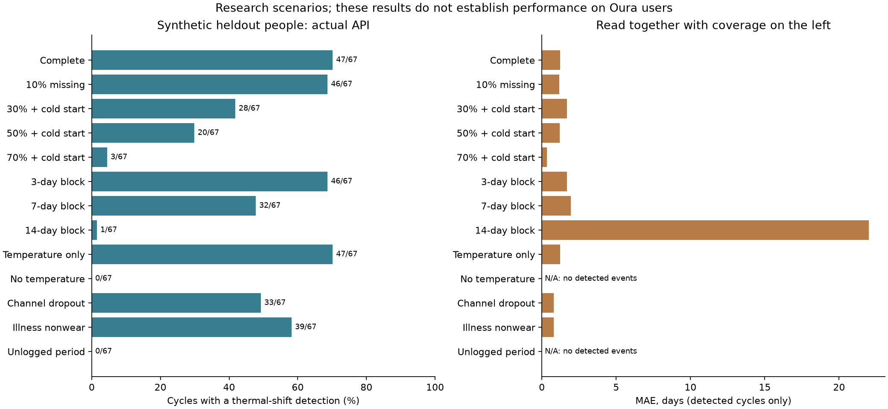

# Перепроверка моделей кольца, версия 2

Технический результат: обученные артефакты, строгая схема входа, API, контейнер, примеры и воспроизводимая оценка. Научный результат: удалось обосновать отдельные физиологические предпосылки и обработку пропусков. Точность на реальной популяции пользователей Oura и сопоставимость с Oura пока не установлены. Синтетическая генерация не устраняет отсутствие совместных реальных измерений кольца и эталонных исходов.

## Что исправлено после независимой проверки

Два независимых рецензента проверили методологию и развёртывание. Убраны требования ко всем семи каналам и нескольким предыдущим циклам; достаточно температуры и одного достоверного начала цикла либо текущего дня цикла. HR, HRV, дыхание и сон необязательны. Отсутствие температуры допускает только календарный режим. LH для работы API не нужен, но требуется как независимый эталон для будущей проверки.

Признаки для утреннего прогноза используют только доступную историю. Шаги текущего дня исключены. Даты и конечные числа проверяются строго; обязательны as_of и контекст. Oura-адаптер объединяет даты readiness, sleep и activity: температура больше не теряется из-за отсутствующего sleep. Для длинного или неопределённого цикла модель возвращает явный статус без ложного точного события. Устаревшее температурное событие при неполных записях менструаций требует уточнения ориентира; консервативный горизонт 14 дней является эксплуатационным допущением, а не клиническим правилом. Эта поправка проверялась на том же стресс-наборе: это регрессионная проверка исправления, не новая независимая внешняя валидация.

Модель не определяет дату новой менструации по одному падению температуры. Если начало нового цикла не отмечено, автоматическое восстановление цикла остаётся нерешённой задачей. В приложении нужен короткий запрос подтверждения начала цикла при статусе uncertain_cycle_anchor.

## Научные источники и генерация

- [Bull et al., 2019](https://www.nature.com/articles/s41746-019-0152-7): 612 613 отобранных овуляторных циклов; средние длительности цикла 29.3 дня, фолликулярной фазы 16.9, лютеиновой 12.4; SD 5.2, 5.3 и 2.4. Это маргинальные параметры выбранной популяции, не совместное распределение всех сигналов.
- [Oura, JMIR 2025](https://www.jmir.org/2025/1/e60667): ретроспективное определение даты относительно LH; 1 155 овуляторных циклов, detection 96.4%, MAE 1.26 дня, 87.9% в пределах ±2 дней. Исключены случаи с более 40% пропусков за 60 дней. Это не F1 прогнозирования будущих фертильных дней и не оценка ложных сигналов в ановуляторных циклах.
- [Исследование запястной температуры, 2018](https://pmc.ncbi.nlm.nih.gov/articles/PMC6265623/): средний сдвиг 0.33°C и неодинаковая выраженность двухфазности. Перенос запястье→палец требует отдельной проверки.
- [Пульс, 2017](https://www.nature.com/articles/s41598-017-01433-9): средние различия +2.1 bpm в фертильном окне и +3.8 bpm в середине лютеиновой фазы относительно менструации. Временные формы и корреляции генератора остаются допущениями.
- [Модель со скрытым состоянием, 2017](https://pmc.ncbi.nlm.nih.gov/articles/PMC5575519/): методологическая опора для пропусков в наблюдениях; наша реализация не является воспроизведением опубликованной модели.
- [TempID](https://zenodo.org/records/20160611): отдельный профиль амплитуды и шума обучен на реальных обработанных данных. Это другой сенсор, данные уже выровнены и двунаправленно заполнены авторами. Исходную утечку устранить невозможно. Исправлено ночное окно на авторское 21:00–03:59 с отнесением к утру и минимумом 6 часовых измерений.
- [STRAW+10](https://pmc.ncbi.nlm.nih.gov/articles/PMC3580996/): стадия репродуктивного старения определяется анамнезом кровотечений; прогноз будущей финальной менструации нельзя валидировать на одном поперечном срезе.

Все численные предпосылки и их происхождение сохранены в models/configs/training/ring_health_evidence_v2.json. Доля ановуляции 10%, болезни, корреляция шума, распределение пропусков, эффекты HRV/дыхания и совместные зависимости явно помечены как сценарные допущения. Они не являются оценками распространённости в целевой популяции. Нельзя просто дополнить 200 анкет искусственными показателями кольца и считать полученные связи обнаруженными в исследовании.

Сгенерированы 360 отдельных участников по пять циклов; разделение по участникам 60/20/20, зафиксированные seed и списки людей. Для обучения используются случайные и блоковые пропуски, выпадение целых каналов, нерегулярные записи менструаций. Выбор модели по validation log loss, порога — на validation; желаемые метрики Oura в подборе не используются. Генератор, таблицы, split и артефакты включены в архив.

## Как обрабатываются редкие измерения

Измерения не заполняются придуманными температурами или LH. Температурная модель интегрирует неизвестное смещение и медленный дрейф, учитывает корреляцию соседних ночей и суммирует правдоподобие только по наблюдённым точкам. Используется смесь возможных амплитуд и компонента отсутствия овуляции; это не валидированная вероятность ановуляции у конкретного человека. Условные квантили даты события не являются клинически калиброванным доверительным интервалом.

При менее восьми температурных ночей или коротком временном охвате возвращается календарная оценка. После длинного перерыва температура перестаёт считаться актуальным свидетельством. Для сообщения о температурном сдвиге нужны наблюдения до и после предполагаемого события, достаточный сдвиг и ограниченная неопределённость. Даже такой статус не означает подтверждения овуляции гормонами.

ML-модели получают показатели наличия, давности и количества наблюдений; бустинг работает с NaN, альтернативный лес имеет imputer только для признаков. Это не восстановление медицинских измерений. Экспериментальные ML-вероятности выдаются отдельно от температурной оценки, чтобы не скрывать их синтетическое происхождение.

## Результаты повторной оценки

Оценивался именно Engine.analyze, используемый API: 72 отложенных синтетических участника, каждый допустимый день последнего заранее выбранного цикла начиная с дня 7, 13 сценариев, 22 230 запросов. Результат без прогноза остаётся в знаменателе. Один и тот же участник встречается в разных сценариях; это парные стресс-проверки, не независимые выборки. random30/50/70 одновременно проверяют холодный старт с одним известным началом цикла; различия с complete нельзя приписывать только доле пропусков. Блоки намеренно расположены около эталонного события для стресс-проверки; эталон не передаётся модели.

| Сценарий | Дни с прогнозом | F1 фертильного дня, порог 0.5 | Сдвиг обнаружен / овуляторные циклы | MAE обнаруженных, дни | Верно ±2 дня / все овуляторные |
|---|---:|---:|---:|---:|---:|
| complete | 98.9% | 0.568 | 47/67 (70.1%) | 1.23 | 65.7% |
| random10 | 98.8% | 0.562 | 46/67 (68.7%) | 1.17 | 64.2% |
| random30 | 98.5% | 0.094 | 28/67 (41.8%) | 1.68 | 37.3% |
| random50 | 98.7% | 0.073 | 20/67 (29.9%) | 1.20 | 26.9% |
| random70 | 99.4% | 0.000 | 3/67 (4.5%) | 0.33 | 4.5% |
| block3 | 98.8% | 0.542 | 46/67 (68.7%) | 1.70 | 61.2% |
| block7 | 98.3% | 0.495 | 32/67 (47.8%) | 1.94 | 46.3% |
| block14 | 96.8% | 0.466 | 1/67 (1.5%) | 22.00 | 0.0% |
| temperature_only | 98.9% | 0.568 | 47/67 (70.1%) | 1.23 | 65.7% |
| no_temperature | 100.0% | 0.465 | 0/67 (0.0%) | — | 0.0% |
| metric_dropout | 99.0% | 0.548 | 33/67 (49.3%) | 0.79 | 46.3% |
| illness_nonwear | 98.9% | 0.556 | 39/67 (58.2%) | 0.79 | 53.7% |
| missed_period_log | 28.5% | 0.000 | 0/67 (0.0%) | — | 0.0% |

Покрытие прогнозом включает календарный режим и само по себе не означает наличие физиологического сигнала. Ошибка только среди обнаруженных циклов может выглядеть хорошо при низком обнаружении. В этом тесте всего пять ановуляторных циклов: даже ноль ложных сигналов не позволяет заявлять высокую специфичность. Интервалы bootstrap по людям и все агрегаты находятся в deployed_missingness_metrics.json. Время вычисления локально: p50 9.6 мс, p95 11.4 мс; это последовательный тест на данном компьютере, не нагрузочная гарантия API.

Отдельный тест обученных классификаторов на отложенных синтетических участниках с аугментацией пропусков:

| Модель | Метрика | Значение | Область доказательства |
|---|---|---:|---|
| Фертильный день, HGB | positive F1 | 0.524 | Синтетические данные, validation-порог 0.27 |
| Постовуляторное состояние, HGB | positive F1 | 0.825 | Синтетические данные, validation-порог 0.36 |
| Репродуктивная стадия, HGB | macro F1 | 0.825 | Только синтетика; не диагноз менопаузы |

Реальные TempID, 3-fold CV по 39 предполагаемым участникам и 59 сериям: MAE всех оценок 4.24 дня; фильтр пригодности пропустил только 3 из 59 циклов (5.1%). MAE этих трёх циклов 2.00 дня не свидетельствует о точности уровня Oura. Исходная обработка авторами, другой сенсор, отбор циклов и отсутствие проспективного протокола ограничивают даже эту слабую оценку. Это отдельный ретроспективный бенчмарк температурного профиля, а не проверка Oura-пути API.

Прежний возрастной baseline NHANES сохранён в v1: предсказывает текущий статус по анкете, не будущую менопаузу по кольцу. Анкета Jordan после удаления дубля содержит 199 строк, не содержит временных рядов кольца и имеет противоречия кодировки. Она не даёт независимой проверки wearable-модели. Реестры открытых источников и скачиваний из v1 сохранены.

## Готовность и проверка

Проверены API-валидация, причинность признаков, temperature-only, отсутствие температуры, перерывы, один/нулевой ориентир цикла, устаревшее событие, Oura union, контрольные суммы и отказ при повреждении артефактов. Linux-контейнер собран и проверен HTTP-запросом с теми же артефактами, токеном и обработкой ошибок. Версии зависимостей serving закреплены; артефакты загружаются один раз при старте. Контейнер работает без root, с read-only FS; запросы с медицинскими данными не пишутся access-log. Проверка контейнера не заменяет нагрузочную проверку и инфраструктурные настройки конкретного приложения.

Оценочная карточка глубокого аудита: проверено 6 материальных классов дефектов; исправления и оставшиеся ограничения записаны в review_findings.json. Методологические ограничения не считаются исправленными кодом. Покрытие таблиц отчёта: 13/13 сценариев; происхождение: 7/7 основных количественных источников размечены; категории dashboard/navigation — неприменимы. Оценки не являются медицинской сертификацией.

| Критерий готовности | Итог | Основание |
|---|---|---|
| Прослеживаемость источников и допущений | Выполнен в проверенном объёме | 7 источников, отдельные device profiles |
| Разделение участников и выбор по validation | Выполнен | Зафиксированные split, без подбора под Oura |
| Пропуски и покрытие фактического inference | Выполнен с ограничениями | 13 сценариев; потерянное начало цикла не восстанавливается автоматически |
| Строгий контракт и артефакты | Выполнен | 47 тестов, startup SHA256, ограниченный вход |
| Переносимость backend | Выполнен для локального smoke test | Docker HTTP 200/401/422; не нагрузочный тест |
| Читаемость графика и знаменателей | Выполнен | Ошибка показана рядом с покрытием |
| Независимая клиническая проверка кольца | Не выполнен | Нет подходящей парной когорты |
| Точность немного ниже Oura / будущая менопауза | Не подтверждены | Сопоставимых независимых исходов нет |

Итого 6/8 критериев исследовательской поставки выполнены в указанном объёме. Это оценка готовности поставки, не точность модели. Для Brier/AP в all-days оценке отсутствующий прогноз условно кодируется нулём как штраф за отказ; такие значения не доказывают калибровку вероятностей. 1 200 строк stage test — четыре маски 300 участников, а не 1 200 независимых женщин.

Развёртывание: docs/ring_health_v2_deployment_ru.md. Технически готов исследовательский backend для демонстрации. Научно обосновано показывать происхождение, наблюдённые данные, неопределённость и статусы. Нельзя заявлять «немного хуже Oura», подтверждённую овуляцию, вероятность беременности или прогноз возраста наступления менопаузы. Для такого заявления нужна новая независимая выборка сырых ночных данных целевого кольца, LH/УЗИ-эталон, ановуляторные циклы, зафиксированные endpoints, пропуски, coverage и person-level разделение до подбора модели.
